# ReadyCAD Mimarisi

ReadyCAD bir modüler monolittir: tek bir çalıştırılabilir dosyadan oluşur, ancak kod **tek yönlü**
bağımlılıkları olan modüllere (CMake statik kütüphanelerine) ayrılmıştır. Bir modül, CMake'te
bağımlı olmadığı bir modülün başlık dosyasını dahil edemez: derleme bu başlığı bulamaz. Böylece
modül sınırlarını bir anlaşma değil, derleyici korur.

## Bağımlılık grafiği

```
                         app (ReadyCAD.exe)
                                │
                               ui ─────────────┐        ImGui, GLFW, nfd (diyaloglar)
                                │              │
                           production          │        üretim hattı: ürün → atölye dosyaları
                                │              │
                             editor          render     OpenGL (glad)
            ┌──────┬──────┬─────┼──────┐       │
           cam   export   │     │   storage    │        nlohmann/json; export: libHaru (PDF)
            └──┬───┘  │   │     │      │       │
            nesting ◄─┼───┼─────┼──────┘       │        Clipper2 (çokgenler)
               │      │   │     │              │
           detailing ─┼───┘     │         ─────┤
               │     i18n ──────┘              │        metinler: arayüz ve belgeler
               │      │                        │
             core ◄───┴────────────────────────┘        glm
```

Oklar sadeleştirilmiştir: her modülün tam bağımlılıkları tabloda listelenmiştir.

| Modül       | Sorumluluk | Aşama | Bağımlılıklar |
|-------------|------------|-------|---------------|
| `core`      | Matematik (mm, double), `Aabb`, mobilya bileşen ağacı (Composite), `Panel`, parametrik yeniden hesaplama; mutfak: modül dizileri, kuşaklar, baza, kesimli tezgah; parçalarda kesimler | 1–3, mutfak, şekiller | glm |
| `i18n`      | Metinler (`TextId` + Türkçe tablo), model öğelerinin adları (parça türleri, kenarlar, delikler, bağlantı elemanları), UTF-8, ASCII'ye çevirme, dosya adları | 1, 6, 8, 9 | core |
| `storage`   | JSON dosyaları: proje (`*.rcproj`), atölye profili (`*.rcprofile`), levha stoku (`stock.rcstock`), kesim ve CNC makinesi ayarları; atölye dosyaları tek klasörde | 5, 7, 8, 9 | core, nesting, cam |
| `detailing` | Kesim ve net ölçüler, kenar bantları, «Sistem 32» delme, bağlantı elemanları, düzlemdeki parça (`FlatPart`, kesimleriyle), bağlantı elemanları listesi | 4, 6, mutfak | core |
| `nesting`   | Levha ve artık stoku (`StockManager`), panel ebatlamada kesim planı (giyotin), CNC'de nesting (No-Fit Polygon), genetik algoritma, arka planda hesap | 7 | core, detailing; Clipper2 (modülün içinde gizli) |
| `export`    | 2D çizimler (`Drawing`), DXF R12, PDF: listeler, kesim planı, montaj çizimi, parça çizimleri | 6, 7 | core, detailing, nesting, i18n; libHaru (modülün içinde gizli) |
| `cam`       | İşleme operasyonları (makineden bağımsız), CNC nesting planlaması (takımlar, sıra, rotalar, içeriden kesimler), lehçesi ayarlanabilen G-code son işlemcisi | 8, mutfak | core, detailing, nesting, i18n; Clipper2 (modülün içinde gizli) |
| `editor`    | Belge, seçim, geri al/yinele, arayüz için işlemler, otomatik detaylandırma, ürünü birleştirilemez yapan değişikliklerin reddi. **OpenGL yok**, bu yüzden pencere olmadan test edilir | 5, 9 | yukarıdakilerin hepsi |
| `production`| Üretim hattı: sipariş → kesilecek parçalar → kesim planı → PDF, DXF, CNC programları, CSV → özetli atölye paketi; pencere olmadan komut satırı | 9 | editor, i18n |
| `render`    | OpenGL 3.3 core: sahne, kamera, fareyle seçim, GPU nesneleri için RAII sarmalayıcılar; prizma olarak şekilli parçalar, desen dokuları | 5, şekiller, desenler | core, detailing, glad; stb_image (modülün içinde gizli) |
| `ui`        | ImGui pencereleri, diyaloglar, dışa aktarma menüsü, kesim planı ve stok pencereleri | 1, 5–9 | editor, production, i18n, render, ImGui |
| `app`       | `main()`: pencere veya pencere olmadan toplu işlem | 1, 9 | ui, production |

GUI modülleri (`render`, `ui`, `app`) yalnızca `READYCAD_BUILD_APP=ON` olduğunda derlenir.
`headless` ön ayarı (preset) geri kalan her şeyi GLFW ve OpenGL olmadan derler ve test eder
(CI için uygundur).

## Dizin yapısı

```
ReadyCAD/
├── CMakeLists.txt            kök: seçenekler, modüllerin sırası
├── CMakePresets.json         debug / release / headless
├── cmake/                    Dependencies (FetchContent), uyarılar, rc_add_module()
├── third_party/glad/         OpenGL 3.3 yükleyicisi (bir kez üretildi ve depoda duruyor)
├── modules/<name>/
│   ├── CMakeLists.txt        rc_add_module(<name> SOURCES ... DEPENDS ... TESTS ...)
│   ├── include/readycad/<name>/   modülün genel (public) API'si
│   ├── src/                  gerçekleştirim (dışarıdan görünmez)
│   └── tests/                modülün birim testleri -> bin/readycad_<name>_tests.exe
├── app/                      giriş noktası; resources/ — program simgesi (exe'ye gömülür)
├── assets/textures/          desen resimleri (CC0, ambientCG), exe'nin yanına kopyalanır
├── tests/integration/        modüller arası ve uçtan uca (Aşama 9) testler
└── docs/
```

## Kurallar

* **Birimler:** her yerde milimetre. **Tür:** `double` (`rc::core::Real`). `float` türüne
  dönüşüm yalnızca `render` modülünde, veriler ekran kartına yüklenirken yapılır.
* **Eksenler:** X — genişlik (soldan sağa), Y — yükseklik (aşağıdan yukarı), Z — derinlik
  (arkalıktan kapağa doğru). Ürünün koordinat başlangıcı sol alt arka köşedir.
* **Ad alanları:** `rc::<module>` (`rc::core`, `rc::detailing`, ...). İstisna: `export` modülü
  `rc::exporting` ad alanındadır, çünkü `export` C++'ta bir anahtar kelimedir.
* **Metinler:** hem pencerelerde hem PDF'te yalnızca `rc::i18n::tr(TextId::...)` üzerinden.
  Kod ve yorumlar İngilizce, arayüz ve belgeler Türkçe yazılır.
* **Kaynaklar:** yalnızca RAII. Elle `new`/`delete` yazılmaz; OpenGL nesneleri yıkıcısı olan
  sınıflara sarılır.
* **Tolerans:** `rc::core::kEpsilon = 1e-6` mm. Uzunluklar `nearlyEqual()` ile karşılaştırılır,
  bunlar için `==` operatörü kullanılmaz.

* **Parça koordinatları:** her bileşenin `box()` değeri üst bileşene göre değil, **ürün**
  koordinatlarında verilir. Yeniden hesaplama zaten her seferinde kökten başlayarak bütünüyle
  yapılır, bu yüzden mutlak koordinatlar daha basittir ve hiçbir ek maliyet getirmez.

## Çekirdek: bileşen ağacı ve yerleşim (Aşama 2–3)

### Ağaç (Composite)

```
Product (ürün: dış ölçüler + ConstructionRules)
└── Carcass (gövde)
    ├── SideWall ×2, TopPanel, BottomPanel, BackPanel     ← basit parçalar, her biri tek Panel
    └── Section (bölme, gövdenin iç hacmi)
        ├── Section, Partition, Section ...                ← X yönünde bölme (ara dikmeler)
        │   └── Section, FixedShelf, Section ...           ← Y yönünde bölme (sabit raflar)
        ├── Shelf ...                                      ← raf pimleri üzerindeki raflar
        ├── DrawerStack → Drawer ×N                        ← çekmeceler
        │                 └── DrawerFront, DrawerBoxSide ×2, DrawerBoxEnd ×2, DrawerBottom
        └── Door ×N                                        ← bölmenin bindirme kapakları
```

* Üst bileşen çocuklarını `shared_ptr` içinde tutar. Çocuk, üst bileşenini sahiplik içermeyen
  sıradan bir işaretçiyle bilir, bu yüzden sahiplik döngüsü oluşmaz. Üst bileşenin yıkıcısı,
  hâlâ yaşayan çocuklardaki bu işaretçiyi sıfırlar.
* `ComponentId` benzersizdir, ad yalnızca insanlar içindir. `remove()` ve `find()` id ile çalışır.
* Bir bileşen **en fazla bir** `Panel` nesnesine sahiptir (`std::optional<Panel>`). Bileşik
  düğümlerin paneli yoktur.
* «Raflı gövde», «kapaklı gövde», «çekmeceli gövde» ayrı sınıflar değil, aynı parçaların farklı
  **bileşimleridir**. Bunları `WardrobeBuilder` (Builder deseni) kurar, hazır modelleri
  `createProduct(CatalogItem)` (Factory deseni) verir. Böylece yeni bir kombinasyon yeni bir
  sınıf gerektirmez, her **parça türünün** ise kendi formülleriyle kendi sınıfı olur.

### Üst bileşen çocukların özel kurallarını nasıl hesaba katar

İlke: **«kısıtlar aşağı iner, boyutlar yukarı çıkar, konumu üst bileşen belirler»**
(Flutter ve Android'deki yerleşim de böyle çalışır).

`FurnitureComponent::layout(slot)` dört adımlı bir Template Method'dur (Şablon Metot):

1. `updateSize(slot)` — parçanın **kendi boyut formülü** (sanal);
2. `updatePosition(slot, size)` — **kendi konum formülü** (sanal);
3. `updatePanel(slot)` — fiziksel parçayı günceller: malzeme, net ölçüler, kenar bantları;
4. `layoutChildren(slot)` — bileşik düğüm çocuklarına slot ayırır ve onların `layout()`
   fonksiyonunu özyinelemeli olarak çağırır.

Üst bileşen **NEREDE** sorusuna karar verir: bir `LayoutSlot` iletir — çocuğun bulunabileceği
alan, artı bağlam (teknolojik kurallar, gövde geometrisi, kapakların izin verilen bindirme
payları). Çocuk **NASIL** sorusuna karar verir: kendi formülüyle slotun içindeki boyutunu ve
konumunu hesaplar. Örneğin raf, bölmeden tam genişlik ve derinlikte bir şerit alır; yanlardaki
boşlukları, kapaktan geri çekme payını ve arkalığa kadar olan boşluğu kendisi çıkarır. Arkalık
gövde çerçevesini alır ve bağlantı stratejisi (`BackMount`) üzerinden, nem kaynaklı genleşme
boşluğunu da hesaba katarak kanala ne kadar gireceğini kendisi hesaplar.

Gövde çocukların sonuçlarını **okur**: iç hacmin açıklığı yeniden hesaplanmaz, yan panellerin,
üst tablanın, alt tablanın ve arkalığın hazır kutularından alınır. Bu yüzden her formül tek bir
yerde bulunur.

Her değişiklikten sonra (`setDimensions`, `setFixedSize`, `addShelf`, `setBackMount`...)
`requestLayout()` çağrılır ve ürünün tamamı kökten itibaren yeniden hesaplanır. Sonuç
değişikliklerin geçmişine değil, yalnızca mevcut parametrelere bağlıdır.

### Alınan konstrüksiyon kararları

| Karar | Varsayılan | Nerede değiştirilir |
|-------|------------|---------------------|
| Üst tabla | yanların üstünde (bindirme) | `Carcass::setTopJoint` |
| Alt tabla | gömme, yanların arasında | `Carcass::setBottomJoint` |
| Arkalık | 3 mm HDF, kanala geçme (kanal 8 mm derin, arka kenardan 16 mm, her yanda 1.5 mm boşluk) | `Carcass::setBackMount`: kanal / arkadan çivili / gömme |
| Raf montajı | raf pimleri üzerinde: her yandan −1 mm, kapaktan −20 mm, arkalığa kadar −2 mm | `Shelf::setMount`: raf pimi / konfirmat (yanlara tam oturur); paylar `ConstructionRules` içinde |
| Bindirme kapaklar | dış kenardan 1.5 mm, kapaklar arasında 3 mm | `ConstructionRules` |
| Çekmeceler | bilyalı raylar, her yana 13 mm, 250–650 uzunlukları 50'şer adımla | `ConstructionRules` |
| Baza | gerekmiyor (karar verildi) | — |

Tüm sayılar `ConstructionRules` içinde toplanmıştır. Atölye bunları koda dokunmadan ayarlayabilir.

### «Parçalar üst üste binmiyor» kontrolü

`findOverlaps(root)` tüm panel çiftlerini `Aabb::intersects` ile kontrol eder. Temas kesişim
sayılmaz. Meşru kesişimleri (kanaldaki arkalık) parça kendisi `allowsOverlapWith()` ile bildirir.
Aşama 3 testleri bu kontrolü her boyut değişikliğinden sonra çalıştırır. Aşama 9'dan beri
düzenleyici de her değişiklikten sonra onu yapar: çakışma ekleyen bir değişiklik reddedilir
(bkz. «Rastgele kullanıcının bulduğu hatalar»).

## Detaylandırma ve delme (Aşama 4, `detailing` modülü)

### Kesim ve net ölçüler

* **Net** ölçü — kenar bandıyla birlikte bitmiş parçanın ölçüsü. Bunu `Panel` saklar.
* **Kesim** ölçüsü — testerenin kestiği ölçü: `cutSize(panel, rules)` =
  net − bant kalınlığı + rodaj (ön frezeleme) payı, bantlı her kenar için. Sonuç
  `rules.cutting.rounding` değerine yuvarlanır. Örnek: 762 × 519 raf, ön kenarda 2 mm ABS,
  1 mm rodaj → 762 × 518.
* `buildCutList()` kesim listesini oluşturur: aynı parçalar adetleriyle birleştirilir, desen
  yönü işareti kesim planına parçanın döndürülüp döndürülemeyeceğini bildirir.
  `edgeBandUsage()` kırpma payıyla birlikte bant tüketimini hesaplar.

### «Sistem 32»

Gövdenin tüm delikleri 32 mm adımlı tek bir dikey ızgara üzerindedir. Izgaranın başlangıcı
alt tablanın orta düzlemidir (`Carcass::system32OriginY()`).

* Raf pimleri üzerindeki raflar **bir deliğe oturur**: çekirdekteki yeniden hesaplama onları
  ızgaranın en yakın deliğine taşır (`rules.system32.snapShelves`). Konfirmatlı raflar tam olarak
  konuldukları yerde kalır.
* Ön delik sırası yan panelin ön kenarından 37 mm uzaktadır. Arka sıra, ön sıradan 32 mm'lik
  tam sayıda adım uzaklıktadır.
* Menteşe ekseni, menteşe tabanının delikleri (eksen ± 16 mm) de ızgaraya düşecek şekilde seçilir.

### Birleşimler geometriden bulunur

`findJoints()` parça çiftlerini tarar ve «birinin dar kenarı diğerinin geniş yüzüne dayanıyor»
durumunu arar: bir eksende kutular birbirine temas eder, diğer iki eksende ise bir alan boyunca
örtüşür. Kalınlık ekseni temas normaliyle çakışan parça geniş yüzü, diğeri dar kenarı verir.
Bu yüzden kodda «neyin neyle birleştiği» listesi yoktur: üst tablanın yanlarla birleşimi, alt
tabla, ara dikmeler, sabit raflar, konfirmatlı raflar ve çekmece kutuları otomatik olarak
bulunur, her yeni konstrüksiyon da ek bir iş gerekmeden birleşimlerine kavuşur.

Bağlantı elemanı `rules.joints.fastener` ile seçilir:

| Bağlantı elemanı | Geniş yüzü temas eden parça | Dar kenarı temas eden parça |
|------------------|-----------------------------|-----------------------------|
| Konfirmat 7×50 | **dış** yüzden (vida başı orada) boydan boya Ø7 | Ø5, derinlik 50 − t + 2 |
| Kavela 8×30 | temas eden yüze Ø8 × 12 | Ø8 × 19 |
| Eksantrik 15 | cıvata için Ø5 × 11 | Ø8 × 34 kanal ve iç yüzde, kenardan 34 mm'de Ø15 × 12.5 yuva |

Bağlantı elemanları birleşimin uçlarından 50 mm içeriye ve aralarında en fazla 300 mm mesafe
olacak şekilde yerleştirilir. Hizalama kavelaları (`alignmentDowels`) her bağlantı elemanından
32 mm uzağa konur.

### Delik çakışmaları

* İki yanında aynı yükseklikte raflar bulunan ara dikme: iki yüzden açılan kör delikler,
  aralarında `minWallBetweenHoles` (1 mm) kalacak şekilde kısaltılır. 18 mm'lik levha için bu,
  10 yerine 8.5 mm'dir.
* Bağlantı elemanının yeri zaten doluysa (ara dikmenin iki yanında sabit raflar), eleman ±32 mm,
  gerekirse daha da öteye, ilk boş yere kaydırılır.
* Aynı delikler (aynı noktaya düşen raf pimi deliği ve menteşe tabanı deliği) tek bir delikte
  birleştirilir.

### Delme neden türetilmiş veridir

Delikler ve kanallar `Panel` içinde saklanır, ancak çekirdeğin her yeniden hesaplaması onları
siler (`Panel::clearMachining()`). Ardından `applyDetailing(product)` onları yeniden oluşturur.
Böylece güncelliğini yitirmiş delme verisi makineye ulaşamaz. Aşama 5'te editör, detaylandırmayı
her değişiklikten sonra otomatik olarak çağırır.

### Kulplar

Kulplar kod değil, **üretim verisidir**: her atölyenin kendi tedarikçisi vardır. Kulp modeli
(`HandleModel`: tür çubuk kulp/düğme kulp, delikler arası mesafe, delik Ø, dış ölçü, tedarikçi,
ürün kodu) `ConstructionRules::handles.catalog` kataloğunda tutulur. `ConstructionRules`
aslında «üretim profilinin» kendisidir; Aşama 5'te dosyaya kaydedilir.

Kapak (`Door`, `DrawerFront`) kulbun kendisini değil, **modele bir referansı ve yerleşim
kuralını** (`HandlePlacement`) saklar. Mesafeler kapağın kenarından en yakın deliğe kadar ölçülür.

* **Kapak:** varsayılan olarak dikey, yüksekliğin ortasında, menteşelerin karşısındaki kenardan
  40 mm içeride. Kapağın menteşe tarafı değiştirilirse kulp kendiliğinden diğer tarafa geçer.
* **Çekmece kapağı:** varsayılan olarak yatay ve ortada.
* Boş `modelId`, «bu atölyenin varsayılan kulbu» anlamına gelir. Profilde değiştirilirse,
  kulbu ayrıca seçilmemiş tüm kapaklarda değişir.
* Çekirdekteki `handleGeometry()`, kulbun ve deliklerinin konumunu hesaplar ve kulbun kapağa
  sığıp sığmadığını kontrol eder. Bunu hem delme hem de 3B görünüm (Aşama 5) kullanır.
* Delme, boydan boya delikleri **ön (görünen) yüzden** açar; böylece matkabın çıkışındaki
  kırılma görünmeyen tarafta kalır. `drillOnMachine = false` anahtarı «montajcı yerinde deler»
  anlamına gelir: programda delik yoktur, ancak kulplar bağlantı elemanları listesinde kalır.
* Kulp katalogda yoksa veya kapağa sığmıyorsa raporda bir uyarı belirir ve hatalı delikler
  oluşturulmaz.

Henüz yapılmadı (Aşama 7–8 adayları): çekmece rayı delikleri, çekmece kapağının bağlantısı.

## Arayüz ve 3B (Aşama 5)

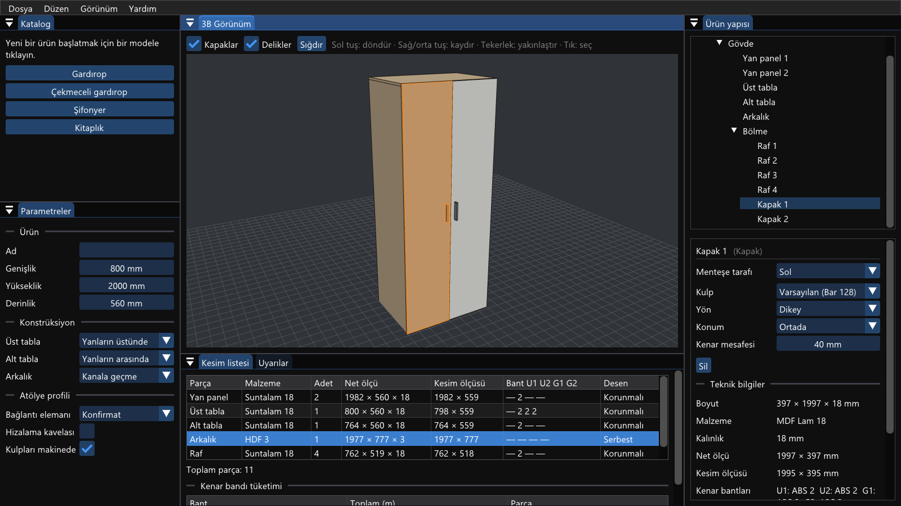

### Katmanlar: kim ne yapar

```
ImGui pencereleri (ui)  ──çağırır──►  işlemler (editor/Operations)  ──►  Document::edit()
      ▲                                                                     │
      │ her karede okur                                                     ▼
Document: product, selection, cutList, detailingReport  ◄── yeniden hesaplama + applyDetailing
      │
      ▼
render::buildScene() ──► Renderer (OpenGL, dokuya) ──► «3B Görünüm» penceresinde ImGui::Image
```

* **Arayüz modeli asla doğrudan değiştirmez:** adlandırılmış işlemleri çağırır
  (`setDimensions`, `setShelfCount`, `splitSection`, `setHandle`, ...). Bu yüzden «giriş alanı →
  model → delme → kesim listesi» yolunun tamamı pencere olmadan testlerle kapsanır
  (`modules/editor/tests`). Aşama 5'in istediği de tam olarak buydu: parametre panelinden modele
  veri aktarımının doğrulanması.
* **`Document::edit()` üç deseni birden uygular:**
  * **Memento** — değişiklikten önce projenin anlık görüntüsü (JSON) saklanır, geri al/yinele
    bunun üzerine kuruludur;
  * **güçlü istisna garantisi** — değişiklik bir istisna fırlatırsa model anlık görüntüden geri
    yüklenir ve belgede başarısız işlemin izi kalmaz;
  * **adımların birleştirilmesi** — kaydırıcıyı sürüklemek her karede bir değişiklik üretir,
    ancak aynı `mergeKey` değerine sahip bu değişikliklerin hepsi, kullanıcı fareyi bırakana
    kadar **tek** bir geri alma adımı oluşturur.
* **Seçim `ComponentId` olarak,** geri alma anlık görüntüsünde ise ağaçtaki bir yol (`TreePath`)
  olarak saklanır. Geri almadan sonra nesneler yeniden oluşturulur, ancak seçim ağacın aynı
  yerinde kalır.
* **3B görünüm:**
  * sahne (`render::Scene`) modelden OpenGL olmadan kurulur, bu yüzden içeriği ve fareyle seçim
    (kutulara karşı ışın) test edilebilir;
  * OpenGL nesneleri RAII ile sarılmıştır (`GlName<Deleter>`), GPU kaynak sızıntısı mümkün
    değildir;
  * görüntü 4× MSAA'lı ekran dışı (offscreen) bir arabelleğe çizilir ve ImGui onu yerleştirilebilir
    (dockable) bir pencerede doku olarak gösterir.
* **3B'de kontrol:** sol tuş — döndürme, sağ veya orta tuş — kaydırma, tekerlek — yakınlaştırma,
  tıklama — parça seçimi. Seçilen parça vurgulanır ve ağaç ona kadar açılır.

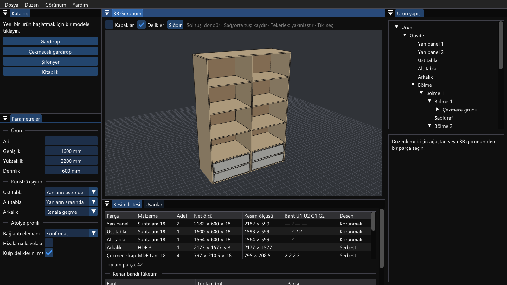

### Pencereler

| Pencere | İçerik |
|---------|--------|
| Katalog | hazır modeller (Factory `createProduct`) |
| Parametreler | dış ölçüler (kaydırıcılar), gövde konstrüksiyonu, atölye profili (bağlantı elemanı, kulplar delinsin mi) |
| 3B Görünüm | 3B görünüm, «Kapaklar» / «Delikler» anahtarları, «Sığdır» |
| Ürün yapısı | **üstte** ürün ağacı, **altta** seçili öğenin özellikleri: düzenlenebilir parametreler ve teknik veriler (net/kesim ölçüsü, kenar bantları, delikler) |
| Kesim listesi | kesim ölçüleriyle parça listesi ve kenar bandı tüketimi |
| Uyarılar | detaylandırma uyarıları |

### Dosyalar

* `*.rcproj` — proje: tasarım niyeti (dış ölçüler, yapı, parça bazında seçimler) ve projenin
  oluşturulduğu atölye kuralları. Geometri ve delme **kaydedilmez**: açılışta yeniden hesaplanır,
  bu yüzden dosya güncelliğini yitirmiş delme verisi içeremez.
* `*.rcprofile` — atölye profili (`ConstructionRules` + kulp kataloğu). «Dosya → Atölye profili»
  onu mevcut projeye yükler; bu işlem geri alınabilir.
* Eksik alanlar varsayılan değerlerle doldurulur, böylece eski dosyalar yeni ayarlar eklendikten
  sonra da açılır.

Arayüzde henüz olmayan: detaylandırma uyarılarının Türkçeye çevrilmesi (şu an İngilizce) — bu,
Aşama 10'un görevidir.

## Dışa aktarma: DXF ve PDF (Aşama 6, `export` modülü)

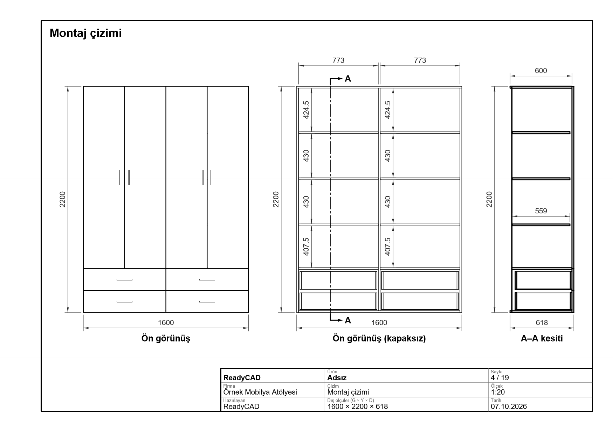

### Tek çizim, iki biçim

```
detailing::FlatPart ──► drawPart() ─────────┐
core::Product ───────► drawProductView() ───┼──► Drawing ──► writeDxf()           CAD/CAM için DXF R12
tablolar, antet ─────► buildDocumentation() ┘   (katmanlar   savePdf() (libHaru)  insanlar için PDF
                       └─ sayfalar = Drawing     + öğeler, mm)
```

* **`Drawing`** — derleyicideki IR gibi bir ara 2D gösterimdir: çok sayıda «ön uç» (parça
  çizimi, ürün görünüşleri, tablolar) ve iki «arka uç» (DXF, PDF). Yeni bir biçim (SVG, yazdırma)
  bir arka uç daha demektir; yeni bir çizim türü ise hemen tüm biçimlerde kullanılabilir.
  * **Katman** çizgilerin görünüşünü belirler: ad, DXF için ACI rengi, PDF için baskı rengi,
    çizgi tipi (sürekli, kesik, kesik-noktalı) ve kalem kalınlığı 0.18 / 0.25 / 0.5 mm (ISO 128).
  * **Temel öğeler:** doğru parçası, çoklu çizgi (kapalı, dolgulu), daire, metin (büyük harf
    yüksekliği, hizalama, döndürme) ve ölçü.
  * **Ölçü** bir çizgi kümesi olarak değil, ölçü olarak saklanır. Her arka uç onu yardımcı
    çizgilere, oklara ve sayıya kendisi ayırır (`explode()`); kısa ölçülerin okları dışarıda
    olur. Sayfaya 1:20 ölçekle yerleştirilirken ölçü **gerçek** uzunluğu hatırlar. Bu hatayı
    («1600» yerine «80») görsel kontrol buldu, artık bir test yakalıyor.

### Düzlemdeki parça: `FlatPart` (`detailing` modülü)

`PanelFrame` delikleri parçanın yerel eksenlerinde saklar, ancak bu eksenler insanın gördüğünün
ayna görüntüsü olabilir. `flatten()` parçayı **seçilen yüzden** görüldüğü gibi açar: u — uzunluk
boyunca sağa, v — yukarı, koordinat başlangıcı net parçanın sol alt köşesinde.

* **Aynalama yok.** Yerel eksen üçlüsü (uzunluk, genişlik, kalınlık) sol el sistemiyse veya alt
  yüzden bakılıyorsa v ekseni ters çevrilir. Bir test bunu katalogdaki tüm modellerin tüm
  parçaları için dünya geometrisi üzerinden kontrol eder.
* **A ve B yüzleri** (parçanın Top ve Bottom yüzleri). `ViewFace::Auto` daha çok işleme olan yüzü
  seçer: her iki yan panelde bu iç taraftır, oysa sol panelde bu Top, sağ panelde Bottom yüzüdür.
* **Delikler:** `Near` (görünen yüzde), `Far` (karşı yüzde, kesik çizgiyle çizilir), `Edge`
  (dar kenarda: giriş noktası, yön, derinlik, yüzeyden yükseklik).
* **Kontur:** hangi kenarın (U1/U2/G1/G2) çizimin hangi tarafında olduğu ve neyle kaplandığı.
* **Ham parça** (rodaj payını içeren kesim ölçüsü) aynı koordinatlarda.

DXF ve PDF bu gösterimin üzerine kuruludur. Aşama 7–8'de onu nesting (kontur) ve CNC (tek
taraftan işleme) de kullanacak.

### DXF

* **R12 sürümü (AC1009).** Onu herkes okur: AutoCAD, LibreCAD, QCAD, kesim ve CNC programları.
  Nesne tanıtıcıları (handle) gerektirmez, bu yüzden dosya basit ve okunabilirdir.
  Yapı: `HEADER → TABLES (LTYPE, LAYER, STYLE) → BLOCKS → ENTITIES → EOF`.
* **Katmanlar, CAM programıyla yapılmış bir sözleşmedir:**

| Katman | İçeriği |
|--------|---------|
| `CONTOUR` | net parçanın konturu (kapalı çoklu çizgi) |
| `CUT_CONTOUR` | testereden çıkan ham parça |
| `CUTOUT` | boydan boya kesim (tezgahta evye, kablo deliği, herhangi bir parçada iç kesim), içeriden frezelenir |
| `EDGE_BAND` | bantlı kenarların işaretleri |
| `DRILL_D5_Z13` | görünen yüzde Ø5, 13 derinliğinde delikler (üstten delinir) |
| `DRILL_BACK_D7_Z18` | karşı yüzdeki delikler (parçanın çevrilmesi gerekir) |
| `DRILL_EDGE_D8_Z30` | dar kenar delikleri: giriş noktasından başlayan delik konturu |
| `GROOVE_W4_Z8` | 4 genişliğinde ve 8 derinliğinde kanal (karşı yüzde `GROOVE_BACK_...`) |
| `TEXT`, `DIMENSIONS` | yazılar ve ölçüler (CAM bunları atlar) |

  Katman adındaki ondalık kısım `p` ile yazılır: `DRILL_D15_Z12p5`.
* **Türkçe harfler:**
  * metinde `\U+XXXX` olarak yazılır, bu her kod sayfasında çalışır;
  * çap işareti `⌀`, AutoCAD kodu `%%c` olur;
  * katman ve dosya adları ASCII'ye çevrilir (`Çekmece yanı` → `Cekmece_yani`), çünkü makine
    yazılımları ve flash bellekleri bununla sorunsuz çalışır.
* **Dışa aktarma** («Dışa aktar» menüsü):
  * tüm parçalar tek dosyada, satırlar halinde, «numara, ad, adet, ölçü» etiketiyle;
  * her parça `<proje>_DXF` klasöründe kendi dosyasında, örneğin `03_Raf_771x558.dxf`.

  Levha yerleşimini (Aşama 7) aynı `drawPart()` ve ötelemeli, döndürmeli `Drawing::append()` çizer.

### PDF: atölye için dokümantasyon

| Sayfa | İçerik |
|-------|--------|
| Genel bilgiler | ürün, dış ölçüler, parça sayısı, kenar bandı tüketimi, levha ihtiyacı (m²), uyarılar, ön görünüş |
| Kesim listesi | parça listesi: No, parça, malzeme, adet, net ve kesim ölçüsü, U1 U2 G1 G2 bantları, desen. Uzun tablo, başlığı tekrarlanarak sonraki sayfalara devam eder |
| Kenar bandı ve bağlantı elemanları | kenar bandı tüketimi ve donanım: konfirmatlar, kavelalar, eksantrikler, raf pimleri, menteşeler, kulplar (ürün koduyla), çekmece rayları |
| Montaj çizimi | ön görünüş, kapaksız ön görünüş, dış ve montaj ölçüleriyle A–A kesiti |
| Parça çizimi | her farklı parça için: kenar bantları, delikler ve kanallarla çizim + delik tablosu (yüz, X, Y, Z, Ø, derinlik, tür) |

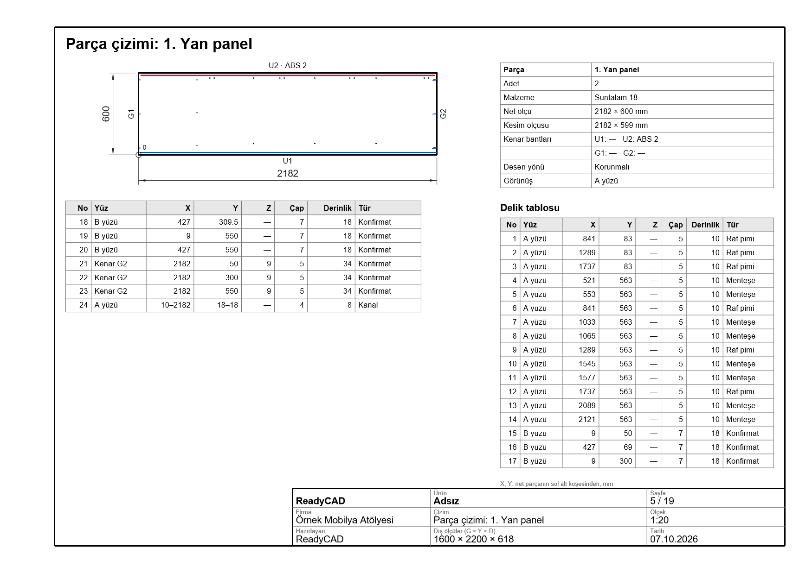

* **Sayfa biçimi:**
  * A4–A1, dikey veya yatay;
  * ISO 5457'ye göre çerçeve (solda 20 mm ciltleme payı);
  * sağ alt köşede 180 × 21 mm antet: ürün, sayfa adı, sayfa n / N, ölçek, tarih, firma,
    hazırlayan.
* **Ölçek** standart diziden seçilir: 1:1, 1:2, 1:5, 1:10, 1:15, 1:20, 1:25, 1:50…; çizimin
  ölçüleriyle birlikte sayfaya sığdığı en büyük ölçek alınır. Montaj çiziminin görünüşleri tek
  sıraya dizilir; iki sırada ölçek daha büyük oluyorsa (dikey A4) iki sıraya.
* **Ürün görünüşleri** birinci açı izdüşümüyle (ISO E, Avrupa yöntemi) birbirine bağlı olarak
  kurulur: bir sıradaki tüm görünüşler aynı zemin çizgisi üzerinde durur.
  * A–A kesiti, kapaklar arasındaki aralığa denk gelmemek için ilk bölmeden, genişliğinin
    %40'ından geçer.
  * Kesilen parçalar griyle doldurulur, kesit düzleminin ötesinde en yakın panele kadar her şey
    görünür.
* **Görünmeyen çizgilerin kaldırılması.** Tüm parçalar dikdörtgen prizmadır, bu yüzden kesin
  algoritma basit olur: bir parçanın kenarı yalnızca, izleyiciye tamamen daha yakın duran bir
  parçanın örtmediği yerlerde çizilir. Çakışan doğru parçaları birleştirilir.
* **Ölçüler:**
  * dış ölçüler: genişlik, yükseklik, derinlik (kapaklı ve kapaksız);
  * montaj ölçüleri: görünüşün üstünde zincir halinde bölme genişlikleri, bölmelerin içinde
    raflar arası açıklıklar, kesitte raf derinliği;
  * iç ölçü yalnızca sayı okların arasına sığıyorsa çizilir: küçük ölçekte aksi halde karmaşa
    ortaya çıkar.
* **libHaru** (C, FetchContent):
  * TrueType yazı tipini yalnızca kullanılan gliflerden oluşan bir alt küme olarak gömer, UTF-8'i
    anlar, `ToUnicode` tablosu ekler; bu sayede PDF'teki metin aranabilir ve kopyalanabilir;
  * zlib olmadan derlenir: sayfalar sıkıştırılmaz, testler içeriklerini okur, dosya ~0.6–0.8 MB;
  * libHaru başlıkları modülün dışına çıkmaz (`PRIVATE`), dışarıdan yalnızca `Pdf.hpp` görünür.
* **Yazı tipi:** `assets/fonts` klasöründen Noto Sans (Aşama 10) → sistemden Arial / Segoe UI →
  Türkçe Windows-1254 kod sayfasıyla yerleşik Helvetica.
  * Tablolar **aynı** yazı tipinin metrikleriyle (`PdfFontMetrics`) düzenlenir, bu yüzden metin
    hücrelerden taşmaz, fazla uzun olan ise «…» ile kısaltılır.
* Her bölüm ve her parça için PDF **yer imleri** (soldaki içindekiler).

### Arayüz

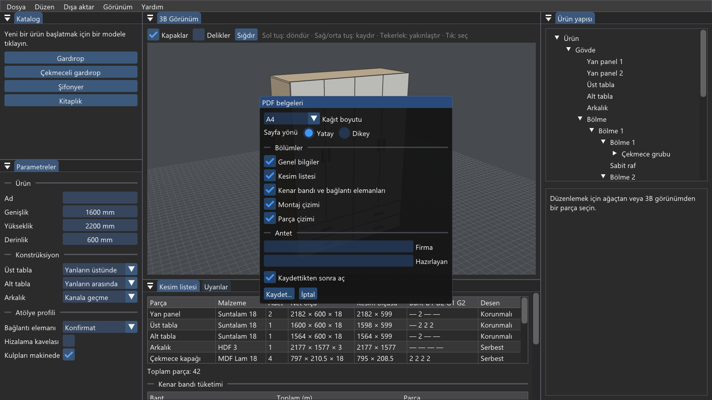

* **Dışa aktar** menüsü:
  * **PDF belgeleri…** (Ctrl+P): kağıt boyutu, sayfa yönü, bölümler, antet için firma ve
    hazırlayan, «kaydettikten sonra aç»;
  * **Tüm parçalar tek DXF dosyasında…**;
  * **Her parça ayrı DXF dosyasında…**.
* «Kesim listesi» penceresi bağlantı elemanları listesini de gösterir. Bu liste, kesim listesi ve
  bant tüketimi gibi `Document` nesnesinin türetilmiş verisidir: her düzenleme, geri alma ve
  yinelemeden sonra yeniden hesaplanır.

### Bu aşamadaki diğer değişiklikler

* **`i18n` modülü.** Metinler `ui` modülünden taşındı: PDF de Türkçe konuşuyor, `export` ise
  `ui` modülüne bağımlı olamaz (grafik tek yönlü). Tüm uygulama için tek bir metin kataloğu var.
* **Her ön ayarın kendi bağımlılık klasörü var** (`build/<preset>/_deps`). Önceden ortak
  `build/_deps`, Debug ve Release bayraklarıyla derlenmiş bağımlılık nesne dosyalarını
  karıştırıyordu.
* **`tools/render_pdf.ps1`**, PDF sayfalarını Windows'un yerleşik motoruyla PNG'ye dönüştürür.
  Sayfa düzeni gözle bu şekilde kontrol edildi, bu bölümün görselleri de böyle hazırlandı.

### Aşama 6 testleri

| Ne test ediliyor | Dosya |
|------------------|-------|
| Düzlemdeki parça: eksenler, aynalama, yüzler, ham parça = kesim ölçüsü | `detailing/tests/FlatPartTests.cpp` |
| Bağlantı elemanları listesi: atölye seçimine göre konfirmat/kavela, menteşeler, raf pimleri, çekmeceler | `detailing/tests/HardwareListTests.cpp` |
| Çizim modeli: katmanlar, ölçekleme, ölçüler, metin hizalama | `export/tests/DrawingTests.cpp` |
| **DXF: bölümler (section), katman tablosu, temel öğeler**, Türkçe harflerin kaçış dizileri, parça dosyaları | `export/tests/DxfTests.cpp` (+ bağımsız mini DXF ayrıştırıcı) |
| Görünüşler: görünmeyen çizgiler kaldırılmış, kesit, dış ve montaj ölçüleri | `export/tests/ProductViewTests.cpp` |
| **Belgeler: tablo verileri sayfalara aktarılıyor**, başlık tekrarıyla sayfa geçişi, biçim ve yön, antet, ölçek | `export/tests/DocumentationTests.cpp` |
| PDF: başlık, sayfa sayısı, MediaBox, Türkçe metin, yer imleri, gömülü TTF | `export/tests/PdfTests.cpp` |
| Editördeki bir düzenleme PDF'e ve DXF'e ulaşıyor | `tests/integration/ExportPipelineTests.cpp` |

Henüz yapılmadı:
* PDF sıkıştırma (zlib);
* çekmece rayı delikleri (Aşama 7–8);
* detaylandırma uyarılarının Türkçeye çevrilmesi (Aşama 10).

## Kesim ve nesting (Aşama 7, `nesting` modülü)

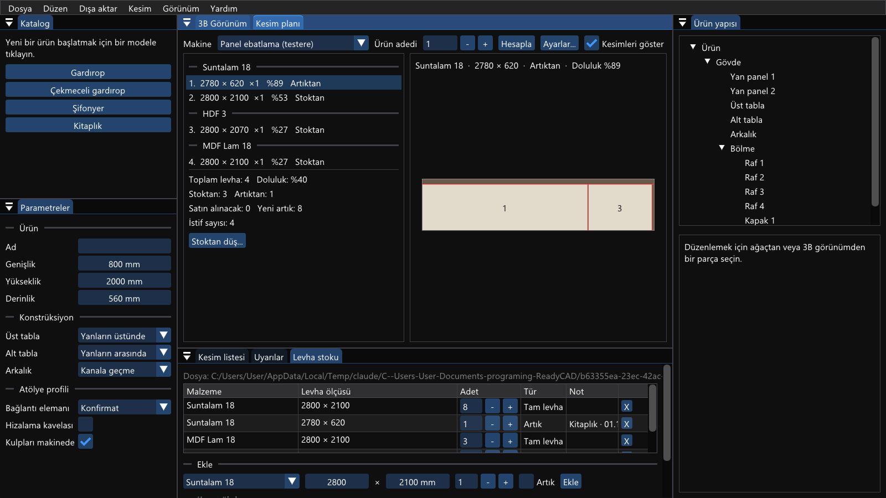

### İki makine, iki ayrı görev

Mobilya atölyesi levhaları iki tür makineyle parçalara ayırır ve her birinin kendi kuralları
vardır.

| | Panel ebatlama (testere) | CNC nesting (freze) |
|---|---|---|
| Nasıl keser | testere tüm parçayı boydan boya keser (giyotin kesim), levhalar istif halinde kesilebilir | freze her parçanın konturunu dolaşır ve levhayı kurban tablaya kadar boydan boya keser |
| Parçalar | yalnızca dikdörtgen (şekilli parça dış ölçüsüyle) | her kontur |
| Parçalar arasında | testere kalınlığı, 4.4 mm | freze çapı, 12 mm, artı ek aralık |
| Levha kenarları | her kenardan 10 mm tıraşlama; artığın kenarları zaten temiz | 10 mm kenar payı |
| Yerleşim | şeritler → sütunlar → sütundaki parçalar (kademe 1–4) | No-Fit Polygon, parça olabildiğince sola, sonra aşağıya |
| Artık | son şeridin üstünde levha boyunca bir şerit, şeritlerin uçları | sağda levhanın tüm genişliğinde bir şerit |
| Aynı levhalar | tek istifte kesilir (60 mm / 18 mm = 3 levha) | hepsi için tek program (Aşama 8) |

İki makine de aynı görev tanımını, aynı genetik algoritmayı ve aynı sonuç yapısını kullanır.
Yalnızca **kod çözücü** (decoder) farklıdır: algoritmanın bir bireyini kendi makinesinin
kurallarına göre bir yerleşime dönüştürür.

### Stok: `StockManager` ve `Sheet`

* `Sheet` bir stok kaydıdır: malzeme (ad, kalınlık, desen), uzunluk × genişlik, adet, artık
  olup olmadığı ve bir not («Gardırop · 08.10.2026»). Uzunluk X yönündedir, desen yönü budur.
* Parça yalnızca kendi malzemesinden bir levhadan kesilir: adı ve kalınlığı aynı olmalıdır.
* `offers(material)` neyden kesilebileceğini deneme sırasıyla verir:
  1. artıklar, en küçüğünden başlayarak: en ucuz onlardır ve stokta yer kaplarlar;
  2. stoktaki tam levhalar;
  3. satın alınacak levhalar, adet sınırı olmadan. Ölçüleri bu malzemenin ilk tam levha
     kaydından alınır. Adedi 0 olan bir kayıt da olur: satın alınacak levhanın ölçüsünü
     belirtir. Kayıt yoksa 2800 × 2100 standart levha alınır.
* Kesim planı penceresindeki «Stoktaki artıkları kullan» onay kutusu
  (`NestingSettings::useRemnants`, varsayılan olarak açık). Kapatılırsa `optimize()`
  artıkları `offers()` listesinden çıkarır: iş yalnızca tam levhalardan kesilir, önce
  stoktakilerden, sonra satın alınacaklardan. Proje için yeni levha almaya hazır olunduğunda ve
  artıklar başka işlere saklandığında böyle yapılır. Bu işten çıkan yeni artıklar, levhalar
  stoktan düşülünce yine stoğa eklenir. Seçim makineyle birlikte `settings.json` dosyasında
  saklanır, plan da onu `NestingResult::settings` içinde hatırlar: `OZET.txt` özeti ve PDF'teki
  kesim sayfası «Stoktaki artıklar kullanılmadı» yazar. `--no-remnants` seçeneği aynısını tek
  bir çalıştırma için yapar, ayar dosyası değişmez.
* 300 × 200 mm'den küçük parçalar (`RemnantRules`) fire, büyükleri kullanılabilir artıktır.
* `consume(result)` kesimden sonra çalışır: kullanılan levhaları stoktan düşer ve yeni
  artıkları notuyla ekler. İşlem ya tamamen yapılır ya da hiç yapılmaz. Stok değişmiş ve
  levhalar artık yetmiyorsa hata verir, stok olduğu gibi kalır.
* Stok projeye değil atölyeye aittir. Kullanıcı klasöründeki (`%APPDATA%\ReadyCAD`)
  `stock.rcstock` dosyasında durur ve tüm projelerde ortaktır; böylece bir siparişin artıkları
  bir sonrakine kalır.
* **Neden veritabanı değil de JSON.** Kayıt sayısı yüzlerle sınırlı, kullanıcı tek, dosya gözle
  okunabiliyor ve yeni bağımlılık gerekmiyor. Yazma atomiktir: önce `stock.rcstock.tmp` yazılır,
  sonra eski dosyanın üzerine yeniden adlandırılır. Artık projeler dahil tüm dosyalar böyle
  yazılıyor. Stoku birkaç bilgisayar paylaştığında veritabanı (SQLite veya sunucu) gerekecek.

### Kesilecek parçalar

* `partsFromCutList()` kesim listesinin her satırı için bir parça oluşturur, adedi ürün
  sayısıyla çarpar. Kontur, `FlatPart` koordinatlarındaki kesim parçasıdır: başlangıç net
  parçanın sol alt köşesinde, parça işlemesi fazla olan yüzü yukarı bakacak şekilde durur. CNC
  nesting yukarıdan deler; bu yüzden Aşama 8'de `FlatPart` delikleri levhaya konturla aynı
  dönüşümle geçecek.
* **Döndürmeler** yalnızca 90°'lik adımlarla, tam olarak, sinüs kullanmadan yapılır.
  Dikdörtgene 0° ve 90° yeter: 180° döndükten sonra aynı görünür. Desenli parça yalnızca 0°
  veya 180° yerleştirilebilir, yoksa desen levhaya dik gider.
* Her malzeme ayrı ayrı yerleştirilir: bunlar birbirinden bağımsız görevlerdir.

### Genetik algoritma (deepnest şeması)

* **Birey**, parçaların yerleştirilme sırası ve her parçanın dönüşüdür. **Kod çözücü** parçaları
  sırayla, açgözlü biçimde yerleştirir: her biri sığdığı ilk levhaya, o levhadaki en iyi yere.
  Açık levhaların hiçbirine sığmazsa `offers()` sırasına göre bir sonraki levha açılır.
* **İlk nesil.** İlk birey önce büyük parçaları yerleştirir, bu klasik bir sezgisel yöntemdir.
  Diğerleri, daha yüksek mutasyon oranıyla elde edilen mutantlarıdır: iyi bir başlangıç
  etrafındaki çeşitlilik rastgele sıralardan daha iyidir.
* **Seçim** üçlü turnuvadır. **Çaprazlama**, sırayı koruyan tek noktalı çaprazlamadır: sıranın
  başı A ebeveyninden alınır, kalan parçalar B ebeveynindeki sırayla gelir ve her parça geldiği
  ebeveynin dönüşünü korur. **Mutasyon** komşuların yerini değiştirir ve parçaları döndürür. En
  iyi bireyler (elit) bir sonraki nesle değişmeden geçer. Tüm zamanların en iyi bireyi ayrıca
  saklanır, bu yüzden sonuç bir nesilden diğerine kötüleşmez.
* Bir yerleşimin **maliyeti**, önem sırasıyla:
  1. kaç parçanın sığmadığı;
  2. kullanılan levhaların alanı (mm², tam sayı);
  3. parçaların her levhaya ne kadar uzandığı.

  Üçüncü ölçüt levhanın kalanını tek büyük bir dikdörtgen olarak bırakır.
* **Paralellik.** Bir neslin bireyleri birkaç iş parçacığında çözülür, daha önce görülen
  genomlar bellekten alınır. Rastgele sayıları yalnızca ana iş parçacığı üretir, kod çözücü ise
  saf bir fonksiyondur. Bu yüzden aynı `seed` ile sonuç 1 ve 16 iş parçacığında aynıdır, bunu bir
  test kontrol eder.
* **Ayarlar**: popülasyon büyüklüğü, nesil sayısı, mutasyon oranı, elit sayısı, `seed`, iş
  parçacığı sayısı (0: biri hariç tüm çekirdekler), NFP önbelleğinin bellek sınırı.
  «Donanım yükü» de budur.

### Panel ebatlama: giyotin kod çözücü

Kod çözücü bir «şerit sisteminde» çalışır: u şeritler boyunca, v onlara dik. Levhaya enine
şeritlerde bu, yer değiştirmiş (transpoze) levhadır.

* **Kademe 1** şeritlerdir; şeridin yüksekliğini içindeki ilk parça belirler. **Kademe 2**:
  şerit enine sütunlara kesilir. **Kademe 3**: sütun içine dizilmiş parçalara kesilir (veya
  parça üstündeki fireden ayrılır). **Kademe 4**: sütunundan dar olan parça tıraşlanır.
* `maxStages`:
  * 2: şeritte yalnızca onun yüksekliğindeki parçalar;
  * 3: sütunda yalnızca onun genişliğindeki parçalar;
  * 4: sütunda daha dar parçalar da.
* Testere kalınlığı komşular arasında kaybolur. Tam levha önce her kenarından tıraşlanır,
  artığın kenarları zaten temizdir.
* Parça genomdaki dönüşüyle mevcut şeritlere sığmazsa, desen izin veriyorsa ikinci dönüş
  denenir.
* **Kesimler yapılış sırasıyla**: tıraşlama (0), şeritler (1), sütunlar (2), ek kesimler (3, 4).
  Bu, Aşama 8'deki testere programı için hazır bir temeldir.
* `firstCuts = Auto` iki yönde de yerleştirir ve daha iyisini seçer.
* **İstifler.** Aynı levhalar `count` ile tek bir yerleşimde birleşir. Bir istife
  `maxStackHeight / kalınlık` levha girer: 60 / 18 → 3.

### CNC nesting: No-Fit Polygon

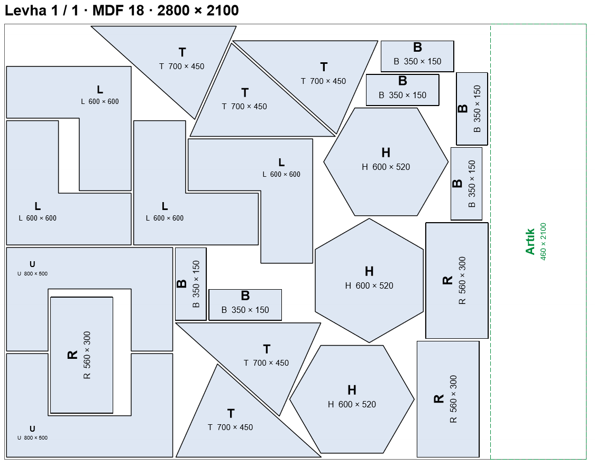

* **NFP(A, B)**, B parçasının başlangıç noktasının B'nin A ile kesiştiği konumlar kümesidir.
  Bu, A ⊕ (−B) Minkowski toplamıdır. NFP sınırında parçalar birbirine değer, dışında kesişmezler.
* **IFR** (inner-fit rectangle), parçanın levha kenar payları içinde kaldığı konumlardır.
* **Serbest bölge** = IFR eksi yerleştirilmiş parçaların NFP'lerinin birleşimi (Clipper2 farkı).
  Her köşesi, parçanın bir komşuya veya kenara değdiği bir konumdur. Köşeler arasından tüm
  parçaların levhaya en az uzandığı, sonra en alttaki, sonra en soldaki seçilir. Parçalar sola
  yaslanır, sağda tek parça bir artık kalır.
* **Freze aralığı.** Her parça aralığın yarısı kadar büyütülür, köşesi «sivri» (miter) olarak
  tamamlanır; bu yüzden yuvarlak köşeyi kapsar. Büyütülmüş parçalar birbirine değerse asıl
  parçalar aralıktan daha yakın olmaz.
* **Tam sayı mikrometreler.** Clipper2 tam sayılarla hesaplar: 1 birim = 1 µm. Birleşimler ve
  farklar kesindir. NFP'ler 1 µm küçültülür, IFR 1 µm büyütülür. Bu olmasa Clipper sıfır
  genişlikteki serbest bölgeyi atardı ve parça tam ölçüsündeki boşluğa giremezdi.
* **Hızlı yol.** İki dikdörtgenin NFP'si bir dikdörtgendir, Clipper gerekmez. İçbükey şekiller
  Clipper2'nin Minkowski toplamıyla hesaplanır; boşluklar deepnest'teki gibi doldurulur: parçanın
  bir komşunun içinden geçmeden ulaşamayacağı yer dolu sayılır.
* **NFP önbelleği.** NFP konumlara değil, yalnızca iki şekle (parça × dönüş) bağlıdır. Bir kez
  hesaplanır ve tüm nesillerin tüm yerleşimlerinde kullanılır; tüm iş parçacıkları onu paylaşır.
  Bellek sınırı (varsayılan 256 MB) aşılınca yeni NFP'ler saklanmaz: hesap uzar, sonuç aynı kalır.
* **Artık**, parçaların sağında, freze kesiminin ötesinde levhanın tüm genişliğinde bir şerittir.

### Sonuç ve görüldüğü yerler

* `NestingResult`: elde edildiği ayarlar, parçalar, levha yerleşimleri (aynı olanlar `count`
  ile birleşmiş) ve hiçbir yere sığmayan parçalar. `usage()` her malzeme için stoktan,
  artıklardan ve satın alınacak levhaları, doluluğu ve yeni artıkları sayar.
* **Arka planda çalışma.** `NestingRun` hesabı bir `std::jthread` üzerinde yapar; pencere
  donmaz ve o ana kadarki en iyi yerleşimi canlı gösterir. «Durdur» hesabı bulunan en iyi
  yerleşimde bitirir; yıkıcı da hesabı durdurur ve iş parçacığını bekler.
* **«Kesim planı» penceresi**:
  * makine, ürün adedi, «Hesapla» (F5) / «Durdur», «Ayarlar...»;
  * ilerleme: nesil, doluluk, NFP önbelleğinin belleği;
  * malzemelere göre levha listesi ve seçili levhanın haritası, parça üzerinde ipucu;
  * hesaptan sonra ürün, stok veya ayarlar değiştiyse uyarı;
  * «Stoktan düş...» levhaları onaydan sonra düşer.
* **«Levha stoku» penceresi**: stok tablosu (adet doğrudan tabloda düzenlenir), levha ve artık
  ekleme, satın alınan levhanın ölçüsü ve en küçük artık.

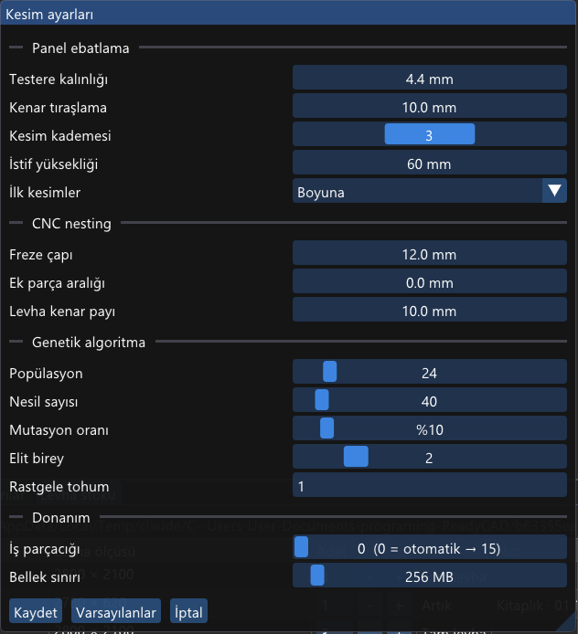

* **PDF, «Kesim planı» bölümü**: genel bakış (makine ve parametreleri, malzemelere göre levhalar,
  tüm yerleşimler, sığmayan parçalar) ve her yerleşim için bir sayfa. Sayfada standart ölçekte
  levha haritası vardır: numaraları ve ölçüleriyle parçalar, artıklar, kesimler. Yanında levha
  bilgileri ve parça tablosu bulunur.

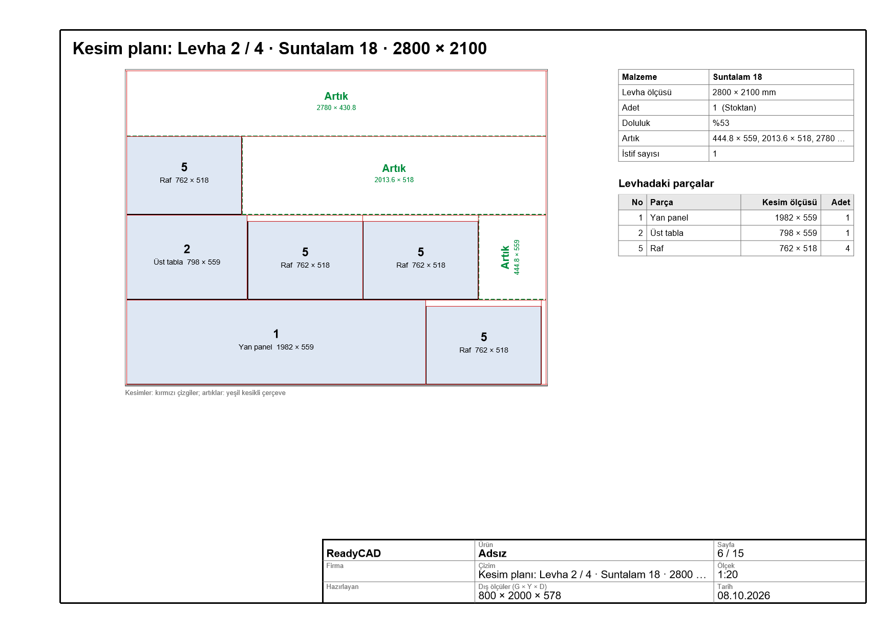

* **DXF**: her yerleşim için bir dosya (`02_Suntalam_18_2800x2100_x2.dxf`). Parçalar yerlerinde,
  delikleri ve kanallarıyla birlikte döndürülmüş durur (`CONTOUR`, `CUT_CONTOUR`, `DRILL_...`,
  `GROOVE_...` katmanları). `SHEET` (levha), `REMNANT` (artıklar) ve `SAW_CUT` (testere kesimleri)
  katmanları eklendi. Döndürme için `Drawing::append()` bir `Transform2D` aldı: 90°'nin katı
  açılar tam hesaplanır, metinler çizimle birlikte döner.

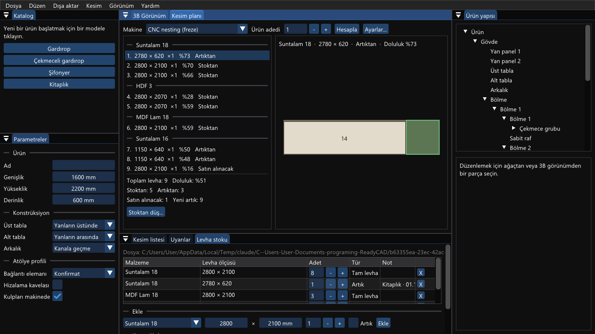

### Bu aşamadaki diğer değişiklikler

* **Clipper2** (Boost License, FetchContent): boolean işlemler, kontur ötelemesi, Minkowski
  toplamları. Kesim algoritmasının kendisi (NFP, kod çözücüler, genetik) modülde yazıldı.
  Clipper2 kendini `-Werror` ile derlediğinden ona `-Wno-error` eklendi: gelecekteki bir
  derleyicinin yeni uyarısı derlemeyi bozmamalı.
* `storage` artık `nesting` modülüne bağımlı (stok dosyası) ve `CMakeLists.txt` içinde ondan
  sonra gelir. Ortak JSON eşlemeleri `src/Json.hpp` dosyasına taşındı.
* `flatPartOf()`, `export` modülünden `detailing` modülüne taşındı: nesting de ona ihtiyaç duyuyor.
* MinGW'deki `std::shared_mutex` (pthread rwlock), birkaç iş parçacığı onu aynı anda ilk kez
  kullandığında yaklaşık on çalıştırmada bir çöküyordu. NFP önbelleği sıradan `std::mutex`'e
  geçti: kilit yalnızca tabloda arama süresince tutulur.
* Test adları yalnızca Latin harfleriyle: Windows'ta `ctest`, Catch2'ye filtreyi başka bir
  kodlamayla iletiyor ve adında «°» veya «—» olan test bulunamıyordu.
* Yeni başlatma parametreleri: `--nesting saw|router`, `--stock`, `--cutting-settings`,
  `--export-pdf`, `--data-dir`. Bu bölümün görselleri onlarla hazırlandı. Gizli `[demo]` testi
  şekilli parçaların nesting'ini içeren bir PDF yazar.

### Aşama 7 testleri

| Ne test ediliyor | Dosya |
|------------------|-------|
| Çokgenler, 90°'lik döndürmeler, şeklin içinde etiket yeri, IFR | `nesting/tests/GeometryTests.cpp` |
| NFP yüzlerce konumda gerçek kesişimle örtüşüyor (dışbükey ve içbükey şekiller, oyuktaki parça) | `nesting/tests/NfpTests.cpp` |
| **Panel ebatlama**: tam yerleşim (konumlar, kesimler, artıklar); yerleşim giyotinle kesilebiliyor, kademe sayısı verilenden fazla değil (bağımsız kontrol), 2/3/4 kademe ve iki yön için; testere kalınlığı, tıraşlama, desen, istifler, önce artıklar, Auto, çok büyük parçalar | `nesting/tests/GuillotineTests.cpp` |
| **Nesting**: dikdörtgen ve şekilli parçalar kesişmiyor, freze çapından yakın değil, levha kenar payları içinde (Clipper'sız bağımsız geometri); L oyuğundaki parça; boşluğa tam oturma; desen; malzemeler ve artık; kesim listesinden parçalar | `nesting/tests/FreeNestingTests.cpp` (+ `LayoutCheck.hpp`) |
| Genetik: aynı `seed` ile her iş parçacığı sayısında ve önbelleksiz aynı sonuç; en iyi kötüleşmiyor; durdurma; hatalı ayarlar | `nesting/tests/GeneticTests.cpp` |
| Arka planda çalışma: ilerleme, iptal, çalışırken yok etme, hata | `nesting/tests/NestingRunTests.cpp` |
| Stok: id'ler, birleştirme, teklif sırası, artıklar, ya hep ya hiç düşme | `nesting/tests/StockTests.cpp` |
| Stok ve ayar dosyaları, bozuk dosyalar, atomik yazma, kullanıcı klasörü | `storage/tests/WorkshopFilesTests.cpp` |
| Levhanın haritası ve DXF'i: her parça yerinde, katmanlar, dosya adları; `Drawing` içinde döndürme; PDF'te kesim sayfaları | `export/tests/SheetDrawingTests.cpp`, `DrawingTests.cpp`, `DocumentationTests.cpp` |
| Stoktan iki gardırop → artıklar stok dosyasına → sonraki sipariş artığı kullanıyor; PDF ve DXF | `tests/integration/CuttingPipelineTests.cpp` |

Henüz yapılmadı:
* artıklar yalnızca dikdörtgen; levhanın karmaşık şekilli kısmı stoka dönmüyor;
* «parça içinde parça» (başka bir parçanın iç oyuğuna yerleştirme): parçalarımızda oyuk yok;
* döndürmeler yalnızca 90°'lik: mobilya için yeterli;
* artıklar her zaman önce kullanılır, «artığı alma» diye ayrı bir gen yok;
* stoktan düşme geri alınamaz (onay sorar); adet stok penceresinde düzeltilebilir;
* mobilya modelinin kendisinde şekilli parçalar (onlar için nesting hazır);
* makine programları: Aşama 8'de CNC nesting için yapıldı.

## CNC programları (Aşama 8, `cam` modülü)

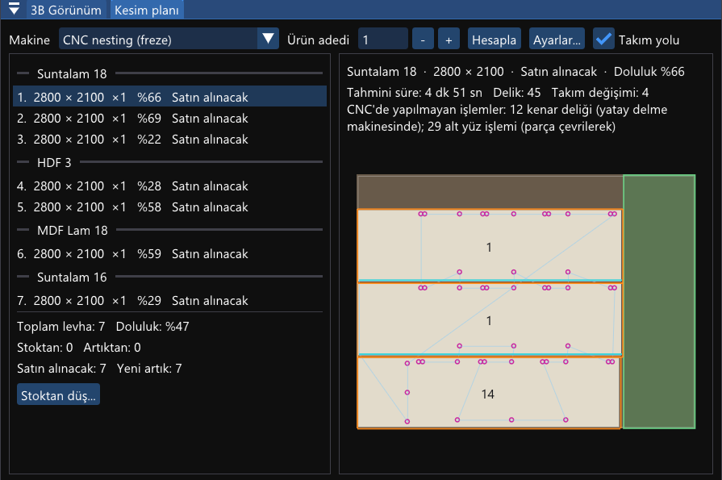

### Üç katman: ne, nasıl, hangi dilde

```
detailing::FlatPart ──► partMachining() ──► Operation         NE yapılacak: delik, kanal, kontur
nesting::NestingResult ─► sheetJob() ─────► SheetJob          levha + yerlerindeki parçalar
                                               │
                    planSheet(makine profili)  ▼
                                            Program           NASIL: takımlar, sıra, derinlikler, hareketler
                                               │
                         Postprocessor::write() ▼
                                       program metni          belirli bir kontrol ünitesinin dilinde
```

* **İşlemler** makineden bağımsızdır:
  * `Drilling`: altı yüzün herhangi birine (`Top`, `Bottom`, `Left`, `Right`, `Front`, `Back`)
    açılan delik — giriş noktası, Ø, derinlik;
  * `Groove`: kanal;
  * `Contour`: parçayı konturundan kesip çıkarmak.

  Parça `FlatPart` koordinatlarında tanımlanır. Levhada işlemler, parçanın yerleşimdeki
  dönüşümüyle döndürülür: `Left` kenar yüzü 90° döndükten sonra `Front` olur.
* **Planlayıcı** bir makine türünün kurallarını bilir. Bu aşamada bu CNC nesting'dir; takımları,
  sırayı, pasoları ve boşta hareketleri o seçer. Sonuç bir `Program`'dır: takım değişimi, boşta
  hareket, kesme hareketi, delme çevrimi, açıklama. Koordinatlar tabladan mm cinsindendir
  (z = 0 levhanın altı). `analyse()` hareket uzunluklarını, delikleri, takım değişimlerini ve
  süreyi hesaplar.
* **Son işlemci** (`Postprocessor`), `Program`'ı bir tür kontrol ünitesinin metnine çevirir.

**Nasıl genişler:**
* Aynı ISO dilini konuşan yeni bir kontrol ünitesi yeni bir **lehçedir** (dialect): yalnızca
  veri, kod yazmak gerekmez.
* Başka bir dosya biçimi bir `Postprocessor` daha demektir.
* Yeni bir makine türü, aynı işlemler üzerinde bir planlayıcı daha demektir. Örneğin yatay delme
  makinesi `partMachining()`'den kenar deliklerini ve alt yüz deliklerini alacak. Bu yüzden
  işlemlerde baştan beri tüm yüzler vardır, CNC nesting yalnızca üstten çalışsa da.

### CNC nesting bir levhayla ne yapar

1. **Delme kafası.** Üstteki delikler matkap matkap delinir; çap ±0.05 mm ile eşleşmelidir.
   Boydan boya delikler kurban tablaya 0.3 mm girer. Her matkabın rotası: en yakın komşu, sonra
   2-opt (rota kısaldığı sürece rota parçalarını yer değiştirir; sonunda kesişme kalmaz). Levha
   bütün ve sağlamken her şey delinir.
2. **Matkabı olmayan delikleri** delikten dar olan en büyük freze açar: ortada dalma,
   dışa doğru halkalar, derinlikte pasolar.
3. **Kanalları** kanaldan geniş olmayan bir freze keser. Kanal frezeden genişse zikzak
   yapan birkaç paralel paso. Derinlik pasolarla alınır.
4. **Konturları** kontur frezesi keser:
   * freze merkezinin yolu, yarıçap kadar büyütülmüş konturdur; köşeler «sivri» (miter) olarak
     tamamlanır, böylece parçanın köşeleri keskin kalır;
   * tırmanma frezelemede kontur saat yönünde dolaşılır;
   * başlangıç, frezeye en yakın köşedir; derinlik pasolarla alınır;
   * **küçük parçalar önce kesilir**: serbest kalınca vakum tablada en kötü onlar tutunur. Benzer
     büyüklükteki parçalar arasından en yakını seçilir.

* **Boşta hareketler.** Güvenli yüksekliğe çıkış, geçiş, yaklaşma yüksekliğine iniş. Son
  işlemci çıkışı geçişten önce, inişi geçişten sonra yazar; bu yüzden takım levhanın üzerinde
  asla alçaktan gitmez.
* **Hatalara karşı koruma** (`CamError`):
  * kontur frezesi, nesting'in bıraktığı aralıktan geniş: komşu parçaları keserdi;
  * frezenin boyu levha kalınlığı artı kurban tablaya yetmiyor;
  * takım tablosu çelişkili (`validate()`).
* **Makinenin üstten yapamadıkları** (`Leftover`) kaybolmaz, parça parça listelenir:
  * kenar delikleri — bunları yatay delme makinesi deler;
  * alt yüzün delikleri ve kanalları — parça çevrilmelidir;
  * takımı olmayan işlemler.

### G-code

Bir gardırop levhasının programının başı ve ilk parçanın kesimi:

```
%
(ReadyCAD 01_Suntalam_18_2800x2100)
(2800 x 2100 x 18 mm, Z0 = TABLE)
G21 G90 G17
G54
T11 M6
S4000 M3
(Delme T11 D5 - 42)
G0 Z38.000
G0 X531.000 Y573.000
G99 G81 X531.000 Y573.000 Z8.000 R21.000 F2500
X563.000 Y573.000
...
G80
...
T1 M6
S18000 M3
(1 Yan panel 2182x599)
G0 X4.000 Y4.000
G0 Z21.000
G1 Z-0.300 F3000
G1 Y615.000 F12000
G1 X2198.000
...
M5
G0 X0 Y0
M30
%
```

* **Lehçe** (`GCodeDialect`), ISO G-code konuşan kontrol ünitelerini birbirinden ayıranlardır:
  * programın başı ve sonu, takım değişimi, iş milinin çalıştırılması — `{tool}`, `{rpm}`,
    `{name}`, `{thickness}`... içeren şablonlar;
  * `G81` delme çevrimleri veya açık `G0/G1/G0` hareketleri;
  * satır numaraları, açıklama biçimi, `%`, ondalık basamak sayısı;
  * Z = 0'ın yeri: tablada mı, levhanın üstünde mi.
* **Hazır ayarlar:**
  * «ISO G-code» — G81 çevrimleri, Z0 tablada.
  * «KDT (NcStudio)» — satır numaraları, `M06`, delikler açık hareketlerle (çevrimi olmayan
    kontrol üniteleri için de uygun). Bunlar **başlangıç değerleridir**: takım numaraları ve
    programın başlangıç satırları gerçek makineyle karşılaştırılmalıdır.
* Çıktı modaldır: satırda yalnızca değişen eksenler, ilerleme yalnızca değiştiğinde yazılır.
  Sayılar `std::to_chars` ile yazılır; bu yüzden nokta her yerel ayarda nokta kalır ve
  «-0.000» hiç çıkmaz.
* Açıklamalar yalnızca ASCII'dir (`asciiFold`), içinde parantez olmaz: kontrol üniteleri çoğu
  zaman UTF-8 anlamaz.
* **Freze yarıçapı telafisini kendimiz hesaplarız**, G41/G42 kullanılmaz: merkez yolu zaten
  programdadır, program kontrol ünitesinin telafiyi nasıl yorumladığına bağlı değildir.

### Arayüz

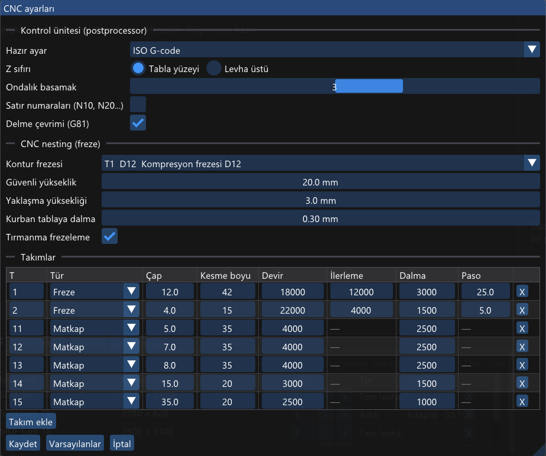

* **«Kesim → CNC ayarları...»**:
  * lehçe ve temel parametreleri;
  * kontur frezesi;
  * güvenli yükseklik, yaklaşma yüksekliği, kurban tablaya dalma;
  * tırmanma frezeleme;
  * takım tablosu: numara, tür, Ø, kesme boyu, devir, ilerleme, dalma, paso.

  Hepsi kesim ayarlarının yanında `settings.json` içinde saklanır (`storage::AppSettings`).
* **«Dışa aktar → CNC programları (her levha ayrı)...»** her yerleşim için bir programı
  `<proje>_CNC` klasörüne yazar (`01_Suntalam_18_2800x2100.nc`). Ardından diğer makinelere
  kalanları gösterir. Kesim planı CNC nesting için hesaplanmış ve güncelse etkindir.
* **«Kesim planı» penceresinde** «Takım yolu» kutusu seçili levhanın takım yolunu gösterir:
  * konturlar turuncu, kanallar açık mavi, delikler halka, boşta hareketler ince çizgi;
  * haritanın üstünde işleme süresi, delik ve takım değişimi sayısı, yapılmayanlar.
* Başlatma parametreleri: `--export-cnc <klasör>`, `--cnc-settings`, `--toolpath`.

### Bu aşamadaki diğer değişiklikler

* `asciiFold`, `decodeUtf8`, `pathToUtf8`, `export` modülünden `i18n/Utf8.hpp` dosyasına taşındı:
  CNC programları da onlara ihtiyaç duyuyor.
* `PartSource` (ürün + kesim listesi) `detailing` modülüne taşındı, `export` içinde bir takma ad
  kaldı.
* `storage` artık `cam` modülüne bağımlı (ayar dosyasında makine profili); `CMakeLists.txt`
  içinde `cam`, `storage`'dan önce gelir.
* Nesting, parça konumlarını 0.01 mm'ye yuvarlar. Bu olmasa temas toleransı (1 µm) programlarda
  `X17.999` gibi sayılar bırakıyordu.
* Testler için küçük bir G-code yorumlayıcı (`tests/support/readycad/test/GCodeReader.hpp`)
  programı yeniden oynatır; onu yazan koddan bağımsızdır.

### Aşama 8 testleri

| Ne test ediliyor | Dosya |
|------------------|-------|
| Yüzler ve yönler; katalogdaki her parçanın tüm delikleri, kanalları ve konturu; yüzlerin parçayla birlikte dönmesi; levha görevi | `cam/tests/OperationsTests.cpp` |
| Rota her noktadan bir kez geçiyor, raf pimi sırası tek hareketle, verilen sıradan en az 2 kat kısa, kendini kesmiyor | `cam/tests/RouteTests.cpp` |
| Takım sırası, derinlikler (kör, boydan boya, menteşe kasesi), diğer makinelere kalanlar; freze yarıçapında kontur, tırmanmada saat yönünde; pasolar; matkapsız deliğin frezelenmesi delik içinde kalıyor; takım yok; çok geniş veya kısa frezenin reddedilmesi | `cam/tests/NestingCenterTests.cpp` |
| **Delikli ve konturlu bir parça için doğru komut sırası**: başlık, takım değişimi, iş mili, çıkış, geçiş, `G81 ... Z R F`, sonraki delik yalnızca X Y, takım değişiminden önce `G80`, dalma `G1 Z-0.3 F`, kontur `G1`, `M5`, `M30`, `%`. **Programın oynatılması**: boşta hareketler yalnızca levhanın üstünde, freze hiçbir parçaya yarıçapından yakın değil, her parça boydan boya kesilmiş, her delik delinmiş (iki hazır ayar, iki Z sıfırı). Lehçeler: satır numaraları, `M06`, açık hareketler, basamaklar, açıklamalar | `cam/tests/GCodeTests.cpp` (+ `GCodeReader.hpp`) |
| Ayar dosyasında makine profili; Aşama 7 dosyası varsayılan makineyi alıyor; hatalı profil reddediliyor | `storage/tests/WorkshopFilesTests.cpp` |
| UTF-8 ve `asciiFold` | `i18n/tests/Utf8Tests.cpp` |
| Çekmeceli gardırop → nesting → programlar → oynatma: her parça temiz kesilmiş, üstteki her delik delinmiş, her delik delinmiş, frezelenmiş veya başka makineye aktarılmış | `tests/integration/CncPipelineTests.cpp` |

Henüz yapılmadı:
* programlar yalnızca CNC nesting için. Panel ebatlama, yatay delme makinesi ve barkodlu
  etiketler yapılmadı (bu aşamada yapılmamasına karar verildi); onlar için işlemler hazır;
* G2/G3 yayları kullanılmıyor: daire 48 doğru parçasıdır;
* çok küçük parçalar için «soğan kabuğu» ve köprüler yok, yalnızca «önce küçükler» sırası;
* dalma doğrudan kontur üzerinde (aralık zaten kesiliyor), rampa yok;
* KDT hazır ayarı gerçek makinede denenmedi;
* takım yolu yalnızca üstten (2B) gösteriliyor.

## Uçtan uca üretim hattı (Aşama 9, `production` modülü)

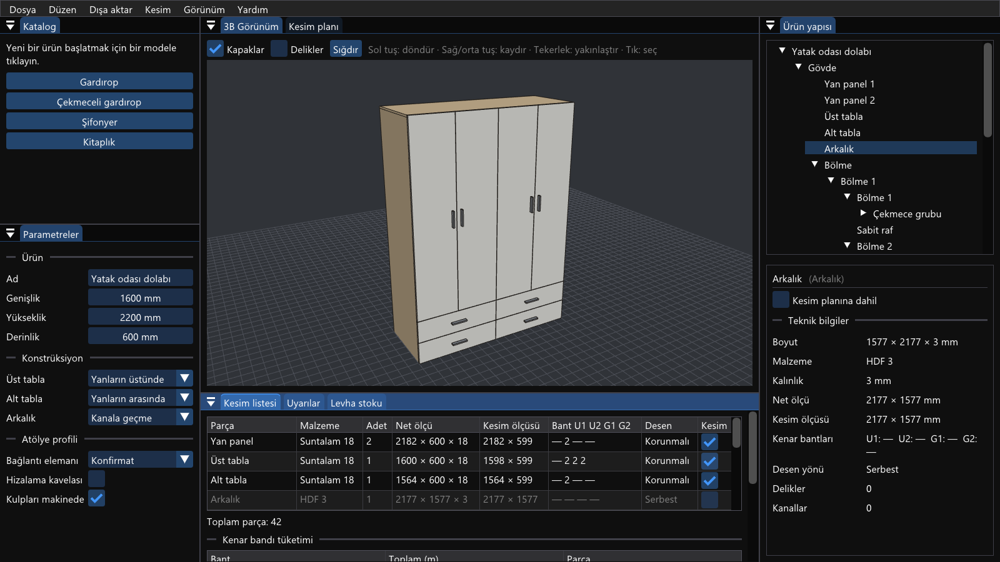

### Üründen dosyalara tek yol

Aşama 9'dan önce modülleri birbirine bağlayan her şey `ui` içindeydi: kesime hangi parçaların
gideceği, kesim planının eskiyip eskimediği, klasör adları, kesim planıyla birlikte PDF'in
hazırlanması. Testler bu kodu görmüyordu, komut satırı seçenekleri de ancak pencere açıkken
çalışıyordu. Artık bunların hepsi OpenGL'siz `production` modülünde ve üç giriş de onu
kullanıyor:

```
                 menü (ui)    komut satırı (app)    testler
                      └──────────────┬──────────────┘
                                     ▼
Order {Document, adet}  ──►  cuttingParts()   kesilecek parçalar: liste satırları × N,
                                     │          kesim planı dışındakiler hariç
                                     ▼
                                planCutting()       stok ve ayarlarla nesting::optimize
                                     │
                                     ▼
       writeDocumentation / writePartDxfs / writeSheetDxfs / writeCncPrograms / writeCutListCsv
                                     │
                                     ▼
                                writePackage()      hepsi tek klasörde + OZET.txt
```

Böylece test, kullanıcının aldığı dosyaların tam olarak aynısını denetler.

* **`Order`**: belge ve kaç ürün yapılacağı. Belge, detaylandırmayı ve kesim listesini zaten
  güncel tutar (bunu `editor` yapar).
* **`planMatches(order, plan)`**: kesim planı ürünün şimdiki hâline mi ait (aynı parçalar, aynı
  adet). Dosya yazan her fonksiyon eskimiş bir planı reddeder (`ProductionError`). Eski plana
  göre yazılmış bir CNC programı projede artık olmayan parçaları keser; bu da boşa giden levha
  demektir.
* **`orderName`**: dosyaların adı. Önce proje dosyasının adı, yoksa ürünün adı, o da yoksa
  «Adsız». Dosya ve klasör adlarında yalnızca ASCII kullanılır (`i18n::safeFileName`):
  makine kontrolörleri ve USB bellekler Türkçe harfleri her zaman tanımaz.

### Atölye için paket

«Dışa aktar → Üretim paketi (hepsi bir klasörde)...» (Ctrl+E) her şeyi yeni bir klasöre yazar:

```
Musteri_Yilmaz_URETIM/
├── Musteri_Yilmaz.pdf                 dokümantasyon (kesim planıyla)
├── Musteri_Yilmaz_kesim_listesi.csv   testere optimizasyon yazılımı veya Excel için liste
├── Musteri_Yilmaz.rcproj              dosyaların üretildiği projenin kendisi
├── DXF/      her parça için bir dosya
├── KESIM/    her levha için bir dosya
├── CNC/      her levha için bir program (kesim planı CNC nesting için ise)
└── OZET.txt  özet
```

* **Yalnızca boş ya da yeni bir klasöre.** Yeni planda olmayan bir levhanın eski programı yeni
  programların yanında durmamalı. Menü yeni adı kendisi seçer: `_URETIM`, `_URETIM_2`, ...
* **Ya hepsi ya hiçbiri.** Önce bütün CNC programları planlanır: freze kesim planına uymuyorsa
  paket ilk dosyadan önce durur. Herhangi bir hatada o ana kadar yazılanlar silinir. Bu
  güvenlidir: klasör boştu, içindekileri biz yazdık.
* **Kesim planı hesaplanmamışsa veya eskimişse**, menü önce onu hesaplar (F5 gibi), paket de
  hesap bitince yazılır. «Durdur» paketi de iptal eder.
* **CSV** panel ebatlamaya köprüdür. Testere için program yazmıyoruz (Aşama 8'de böyle karar
  verildi), ama testerenin kendi optimizasyon yazılımı var ve parça listesini kabul ediyor.
  Ayırıcı «;», ondalık virgül, BOM'lu UTF-8: Türkçe Excel dosyayı soru sormadan açar.
* **Paketteki `.rcproj`**, dosyaların tam olarak hangi hâline göre üretildiği projedir.
  Sonradan «bu parça neden böyle» sorusu çıkarsa cevap yanında durur.
* **`OZET.txt`** insanlar için bir özettir. Sütunlar baytlara göre değil harflere göre
  hizalanır («ş» tek harftir ama UTF-8'de iki bayttır). BOM ve Windows satır sonları sayesinde
  eski Not Defteri de onu doğru okur:

```
ReadyCAD — Üretim paketi
========================

Sipariş   :  Çekmeceli gardırop × 2
Tarih     :  12.10.2026
Ölçüler   :  1600 × 2200 × 618 mm
Parçalar  :  84 (82 kesim planında, 2 kesim dışı)

Kesim planı — CNC nesting (freze)
---------------------------------
Malzeme      Toplam levha  Stoktan  Artıktan  Satın alınacak  Doluluk  Yeni artık
Suntalam 18             5        0         0               5      %63           5
...
CNC programları
---------------
CNC/01_Suntalam_18_2800x2100.nc  × 1  5 dk 45 sn  Delik: 42  Takım değişimi: 3
...
Toplam süre: 32 dk 20 sn

CNC'de yapılmayan işlemler
--------------------------
124 kenar deliği (yatay delme makinesinde)
78 alt yüz işlemi (parça çevrilerek)
```

  Aynı levhaların süresi sayılarıyla çarpılır: iki aynı levhadan oluşan bir istif, aynı
  programın iki kez çalışması demektir.

### Kesim planı dışındaki parçalar

Her panelin «Kesim planına dahil» onay kutusu vardır (`PanelComponent::inCuttingPlan`,
varsayılan olarak açık). Kapalı bir parça kesim listesinde, belgelerde ve kenar bandı
tüketiminde kalır, ama ne kesim planına ne de CNC programlarına girer. Örnekler: hazır kesilmiş
sipariş edilen arkalık veya HDF çekmece tabanı; başka bir atölyenin kestiği parça; ileride
tezgâh.

* Onay kutusu parçanın özelliklerinde ve kesim listesinde «Kesim» sütunu olarak var. Tek
  tıklama satırdaki bütün parçaları tek bir geri alma adımında değiştirir
  (`editor::setInCuttingPlan`).
* Kesim planı dışındaki bir parça, planda olan aynı parçayla aynı liste satırında
  birleşmez. Satır numarası değişmez, böylece yerleşim üzerindeki etiketler PDF ile aynı kalır.
* PDF'te böyle bir satır «*» ve dipnotla işaretlenir, CSV'de «Hayır» yazar, `OZET.txt`'te
  ayrı bir «Kesim planı dışındaki parçalar» bölümü vardır.
* Onay kutusu projede saklanır (`"cutting": false`, yalnızca kapalı olanlar için yazılır).

### Pencere olmadan komut satırı

```
ReadyCAD.exe --open proje.rcproj --count 2 --nesting router --package D:\is\proje
```

Pencere açılmaz, OpenGL gerekmez. Program projeyi (veya bir katalog modelini) açar, atölyenin
stoku ve ayarlarıyla (`--data-dir` veya kullanıcı klasörü) kesim planını hesaplar, paketi
yazar, özeti basar ve çıkar: kod 0 — tamam, 1 — hata (nedeni stderr'de). Stok yalnızca okunur:
levhaları stoktan düşmek pencerede insanın kararıdır.

Release derlemesi kendi konsolu olmayan bir GUI programıdır. Bu yüzden toplu işlem kipinde
kendisini başlatan konsola bağlanır (`AttachConsole`) ve orada UTF-8'i açar. Çıktı bir
dosyaya yönlendirilmişse oraya gider. Kabuk pencereli bir programı beklemez; bu yüzden
betiklerde çıktı bir boru hattına verilir (`ReadyCAD.exe ... | Out-Host`): o zaman PowerShell
programın bitmesini bekler ve çıkış kodunu alır.

### Uçtan uca testler

1. **Kullanıcı yolculuğu** (`tests/integration/UserJourneyTests.cpp`): görev tanımındaki
   senaryo, pencerenin çağırdığı fonksiyonların aynısıyla:
   1. atölye dosyaları (levhalar ve bir artıktan oluşan stok, CNC nesting ayarları) programın
      açılışındaki gibi yazılır ve okunur;
   2. katalogdan çekmeceli gardırop: ölçüler, ad, dört raf (biri konfirmatlı), topuz kulplar,
      üçüncü çekmece (geri al, yinele), kesim planı dışında arkalık;
   3. detaylandırma: çakışma ve uyarı yok, delikler yerinde, çekmece kapakları 3 + 2;
   4. Türkçe adlı bir dosyaya kaydetme ve açma: aynı kesim listesi, aynı delikler;
   5. iki ürünün kesim planı: bütün parçalar yerleşti, arkalıklar yok, satın almadan önce stok
      kullanılıyor;
   6. paket: PDF tam, her DXF okunuyor, her CNC programı yeniden oynatılıyor — yalnızca levhanın
      içinde, kurban tablasından derin değil, yalnızca makinenin takımlarıyla; CSV, özet ve
      paketteki proje ürünle aynı;
   7. stoktan düşme: levhalar stoktan çıktı, yeni artıklar siparişin notuyla geldi.
2. **Her katalog modeli iki makinede**: dosyalara kadar bütün hat.
3. **Rastgele kullanıcı.** Sabit seed'li bir üreteç arka arkaya 40 değişiklik yapar: ölçüler,
   bölme ayırma, raflar, kapaklar, çekmeceler, yükseklikler, malzemeler, kulplar, silmeler
   (imkânsız olanlar dahil: yan panel silinemez), «kesim dışı», konstrüksiyon, geri al,
   yinele. Her değişiklikten sonra:
   * reddedilen değişiklik ürünü bir bayt bile değiştirmedi (proje JSON'u karşılaştırılır);
   * bütün panellerin ölçüleri sonlu ve pozitif;
   * kesim listesi bütün panelleri sayıyor;
   * **hiçbir parça çifti çakışmıyor**;
   * proje kaydedilip aynı hâliyle açılıyor.

   Her 20 değişiklikte bir, bütün hat pakete kadar çalıştırılır, sırayla testerede ve CNC'de.
   Uzun çalıştırma (`[soak]`, gizli): 40 seed × 80 değişiklik, yaklaşık 20 saniye.
4. **Gerçek program** (`app_batch_package`, CTest): `ReadyCAD.exe --catalog 1 --count 2
   --nesting router --package ...`, ardından özette DXF, KESIM ve CNC klasörlerinin olduğu
   denetlenir.

### Rastgele kullanıcının bulduğu hatalar

İlk uzun çalıştırma yaklaşık iki bin parça çakışması verdi. Bunlar beş tür hataydı ve
hepsi testte değil, modeldeydi:

| Ne | Neden | Düzeltme |
|----|-------|----------|
| 18 mm yan panellerin üstündeki 25 mm üst tabla onların içine 7 mm giriyor | `CarcassFrame` bütün gövde için tek bir kalınlık biliyordu | çerçevede dört kalınlık var (sol, sağ yan panel, üst tabla, alt tabla); her formül karşılaştığı parçanınkini alır |
| Çekmece ön-arkaları 18 mm yan panele, yanlar 6 mm tabana giriyor | kutu parçaları kalınlıkları gerçek parçalardan değil `ConstructionRules`'tan alıyordu | `Drawer`, parçalarına gerçek kalınlıklarıyla bir `DrawerBoxFrame` verir |
| Bir bölmenin kapakları alt bölmesindeki çekmece kapaklarını örtüyor | «ön yüzler üst üste binmez» kuralı yoktu | düzenleyicinin genel denetimi (aşağıda) |
| Aynı yükseklikte raflar ya da sığabileceğinden fazla raf | — | düzenleyicinin genel denetimi |
| Birkaç santimetrelik bir bölmedeki çekmecelerin kutusu yüksekliksiz kalıyor | — | düzenleyicinin genel denetimi |

**Düzenleyicinin genel denetimi.** `Document::edit`, değişiklikten sonra ürünün
birleştirilebildiğini denetler: hiçbir panel ölçüsünü kaybetmedi, çakışan parça çifti
artmadı. Aksi hâlde değişiklik reddedilir (`ConstructionError`, Türkçe metinle: «Bu değişiklik
yapılamaz: parçalar çakışır (Kapak — Çekmece kapağı)») ve başarısız her düzenleme gibi geri
alınır. Kural her şey için tektir; yeni parça türleri (mutfak) onu bedavaya alır. Eski bir
sürümden gelen, çakışma içeren proje yine açılır: çakışmalar «Uyarılar» penceresinde (tıklama
parçayı seçer), `OZET.txt`'in başında («DİKKAT») ve komut satırı çıktısında görünür.

Düzeltmelerden sonra: 3200 rastgele değişiklik, 2770'i kabul edildi, hiç çakışma yok.

Kaydetme sırasında yolda bulunan hata: çekmece kutusu parçalarında seçilen malzeme ve kenar
bandı projeye kaydedilmiyordu. Artık dosyada çekmecenin bir `"box"` alanı var (yalnızca
değiştirilmiş parçalar için).

### Bu aşamadaki diğer değişiklikler

* `storage::WorkshopFiles`: atölyenin stoku ve ayarları tek klasörde; `loadStockFile` ve
  `loadSettingsFile` (dosya yoksa boş stok ve varsayılan ayarlar; bozuk dosya sessizce boş stok
  değil, hatadır), `saveStockFile` ve `saveSettingsFile`.
* `exporting::todayText()`, `i18n::safeFileName()`.
* `DxfReader.hpp` ve `PdfReader.hpp` test yardımcıları `tests/support`'a taşındı: onları birkaç
  modülün testleri kullanıyor.
* «Dışa aktar → Kesim listesi (CSV)...»: paketten ayrı olarak CSV.
* Başlatma seçenekleri: `--package <klasör>`, `--count <n>`, `--cut-list`.

### Aşama 9 testleri

| Ne | Dosya |
|----|-------|
| Kesilecek parçalar: adet, kesim planı dışındakiler; kesim planı bir değişiklikten sonra eskir ve geri almadan sonra yeniden geçerli olur; CNC nesting için paket (PDF, DXF, programlar, CSV, proje, özet), testere için (CNC'siz), kesim planı olmadan; yalnızca boş klasör; ya hepsi ya hiçbiri; yeni klasör adları; siparişin adı; Türkçe Excel için CSV | `production/tests/PipelineTests.cpp` |
| «4 dk 12 sn» süresi; bütün levhalarda diğer makinelere kalan işler; levha istifinin süresi; harflere göre hizalama; özetin başında çakışmalar; paketten sonraki mesaj | `production/tests/SummaryTests.cpp` |
| Komut satırı: pencere olmadan paket, makine dosyadan ve seçenekten, Türkçe adlı proje, stok değişmiyor; nedeni ve 1 koduyla hatalar | `production/tests/BatchTests.cpp` |
| «Kesim dışı» onay kutusu: kesim listesinde ayrı satır, nesting'e girmiyor, çekmece kutusu parçalarının seçimiyle birlikte kaydediliyor, satır başına tek geri alma, PDF'te işaret | `detailing`, `nesting`, `storage`, `editor`, `export` |
| Bütün birleşim ve arkalık türlerinde kalın üst tabla, alt tabla veya yan panel; farklı kalınlıklarda kutu parçaları; birleştirilemeyen bir değişikliğin reddedilmesi | `core/tests/CarcassTests.cpp`, `core/tests/SectionTests.cpp`, `editor/tests/OperationsTests.cpp` |
| Klasördeki atölye dosyaları | `storage/tests/WorkshopFilesTests.cpp` |
| **Kullanıcı yolculuğu**; her model iki makinede; rastgele değişiklikler | `tests/integration/UserJourneyTests.cpp`, `tests/integration/RobustnessTests.cpp` |
| Gerçek `ReadyCAD.exe` pencere olmadan paket yazıyor | `app/CMakeLists.txt` (`app_batch_*`) |

Henüz yapılmadı:
* bir kesim planında tek bir ürünün birkaç kopyası olabilir, ama farklı ürünler olamaz (mutfak
  ve dolap birlikte);
* sığmayan raflar ve çekmeceler reddedilir, ama program nasıl düzeltileceğini önermez;
* PDF eski projelerdeki çakışmaları göstermez (onları «Uyarılar» penceresi ve `OZET.txt`
  gösterir).

## Mutfak takımı (Aşama 9'dan sonra)

On aşamalık planda olmayan bir genişletme. Birlikte alınan kararlar:
* çekmeceler dolaplardakiyle aynı (aynı `Drawer` ve `DrawerStack`);
* mutfakta baza gerekir;
* sunta veya MDF tezgah kesim planına alınabilir ya da dışında kalabilir; bunu kullanıcı seçer;
* kuşakların nasıl olacağına ben karar veriyorum; kararım aşağıda;
* köşe mutfakları sonradan eklendi, bkz. «Köşe mutfakları (desenlerden sonra)».

### Bir üründe birden çok gövde

Mutfaktan önce `Product`'ın tam olarak bir `Carcass`'ı vardı. Artık ürünün tek bir çocuğu
var: `Carcass` (dolap, şifonyer, kitaplık) veya `Kitchen`:

```
Ürün                        Product
└── Mutfak                  Kitchen: kendi ölçüleri, tezgah kesimleri
    ├── Alt dolaplar        CabinetRow (Base): soldan sağa modüller
    │   ├── Alt dolap 1     Carcass: üst tabla yerine kuşaklar, baza, dizideki genişlik
    │   │   ├── Yan panel, Ön kuşak, Arka kuşak, Alt tabla, Arkalık, Bölme, Baza
    │   └── ...
    ├── Tezgah              Worktop
    └── Üst dolaplar        CabinetRow (Wall)
        └── Üst dolap 1 ... Carcass
```

Bir mutfakta ürün ölçülerinin anlamı: genişlik dizinin uzunluğu (duvar), yükseklik üst
dolapların üst hizası, derinlik alt gövdelerin derinliği. Geri kalanı mutfağın kendi ölçüleri
(`Kitchen::Sizes`): alt dolap gövdesi 720, üst dolap 720, derinliği 320, tezgah derinliği 600.
Baza yüksekliği bir atölye kuralıdır (`rules.kitchen.plinthHeight = 100`): onu atölyenin satın
aldığı ayaklar belirler. `Kitchen::layoutChildren` yerleşimi buradan çıkar:

```
 ┌──────── üst dolaplar ────────┐  ← üst hiza = ürünün yüksekliği
 └──────────────────────────────┘    wallHeight, derinliği wallDepth
 ════════════ tezgah ═════════════   Tezgah 38 malzemesinin kalınlığı, derinliği worktopDepth
 ┌──────── alt dolaplar ────────┐
 │                              │    baseHeight (gövde)
 └──────────────────────────────┘
   ▔▔▔▔▔▔▔▔▔ baza ▔▔▔▔▔▔▔▔▔▔▔▔▔     plinthHeight (atölye kuralı)
```

Kurallar yine yukarıdan aşağıya: mutfak diziye bir şerit verir, dizi modüle bir sütun verir,
modül kendi parçalarını kendisi hesaplar. Dizideki genişlikler bir bölmenin sütunları gibi
hesaplanır: sabit genişlikli modül genişliğini korur, otomatik olanlar kalanı eşit paylaşır. Bu
formül `LayoutSlot.hpp`'deki ortak `distributeSizes()` fonksiyonuna taşındı; onu hem `Section`
hem `CabinetRow` kullanır. Bu yüzden mutfak 2400'den 2600'e uzayınca yalnızca «otomatik» modül
büyür, evye dolabı 600 kalır.

Her modül kendi kapaklarıyla tam bir `Carcass`'tır. Kapaklar kendi gövdesinin kenarlarından
`frontEdgeGap` (1,5 mm) kadar içeride durur; bu yüzden komşu modüllerin kapakları arasında ayrı
bir kural olmadan `frontGap` (3 mm) oluşur.

Kodun tek gövde varsaydığı yerler ve şimdi ne olduğu:

| Yer | Şimdi |
|-----|-------|
| Delik delme (`applyDetailing`) | gövde gövde: bir birleşim, raf pimi ya da menteşe tabanı asla komşu modüle geçmez. Test, bir modülün üst tabla ucunun komşunun yan paneline değdiği durumu kurar: geometri olarak bir birleşimdir, ama orada konfirmat yoktur |
| Gövde ile ilgili düzenleyici işlemleri | «ürünün gövdesi» değil, gövdenin `ComponentId`'si ile (`setTopJoint(doc, carcass, ...)`) |
| Proje dosyası | `"carcass"` yerine `"kitchen"`, sürüm 2 |
| Arayüz | tek gövdenin değil, seçilen gövdenin özellikleri |

### Yeni konstrüksiyon kuralları

| Parça | Kural | Neden |
|-------|-------|-------|
| **Kuşaklar** (`Rail`, «Ön/Arka kuşak») | üst tabla yerine yan paneller arasında iki şerit, genişlik 100 (`rules.kitchen.railWidth`). Sıradan alt dolaplarda **yatay**: arka kuşak arka kenarlara oturur, arkalık onun kanalına girer. Evye ve ocak dolaplarında **dikey** (kenarı üzerinde): ön kuşak kapağın hemen arkasında, arka kuşak arkalığın hemen önünde; arkalık o zaman kanalsız olarak üste kadar çıkar | tezgah yan panellerin üstüne oturur ve alttan kuşaklardan vidalanır; altında üst tablaya gerek yok. Evyenin veya ocağın altında yatay bir kuşak tam teknenin ya da ocak gövdesinin altına gelirdi |
| **Baza** (`Plinth`) | her alt modülün kendi bazası: gövdenin altında 100 yüksekliğinde bir şerit, ön kenarından 40 geride (ayak ucu payı). Gövdenin kutusu baza bölgesini içerir, gövdenin kendisi daha yukarıdan başlar | bütün mutfak boyunca tek bir şerit 2800'lük levhaya sığmaz ve yine de ek ister. Modül sınırındaki ek görünmez, model basit kalır: baza yalnızca kendi gövdesine bağlıdır |
| Alt dolap | yan paneller alt tablanın üstünde (`bottomJoint = Overlay`) | ayaklar alt tablaya vidalanır, yük ondan geçer |
| Üst dolap | üst tabla yan panellerin arasında, yan paneller alt tablanın üstünde | askılar yan panellerin üst köşelerine takılır; aşağıdan alt tablanın ucu görünür ve o bantlıdır (yan panellerin uçları görünmez) |
| Kulplar | alt kapaklarda üstte, üst kapaklarda altta | elin bulduğu yer |
| **Tezgah** (`Worktop`) | `rules.worktopMaterial` (Tezgah 38), derinlik 600, uzunluk alt dolaplar kadar; önde ve uçlarda bant; **varsayılan olarak kesim planı dışında** | genellikle 4100 mm'lik plaka olarak alınır ve ayrıca kesilir. «Kesim» onay kutusu onu kesim planına alır (o zaman stokta ne gerektiği aşağıda) |
| **Tezgah kesimi** (evye, ocak) | alt modülün özelliği (`Carcass::cutout()`): modülün ortasında, kesimin ön kenarı tezgahın ön kenarından 60 mm geride. Standart: evye 560 × 480 R15, ocak 560 × 490 R5 | cihazların montaj talimatları böyle söyler. Kesim modüle aittir: modülü taşırsanız kesim de taşınır |

60 cm'lik evye modülü için sayılar: yan paneller arası açıklık 564, kesim 560, her yandan 2 mm;
derinlikte kesim 60…540'ı kaplar, dikey ön kuşak 542…560'tadır.

**Kesim sığmalı.** `Kitchen::misplacedCutouts()` yapılamayacak kesimleri bulur:
* tezgahın kenarına veya komşu kesime 50 mm'den az kalıyorsa (`cutoutMargin`);
* kesim kendi modülünün açıklığına düşmüyorsa: planda yan panellerin, arkalığın dışına ya da
  tezgahın altındaki bir kuşağın veya üst tablanın üstüne taşıyorsa (evye teknesi veya ocak
  gövdesi bir parçaya dayanırdı).

Düzenleyici bu kesimleri parça çakışmaları gibi sayar: sayılarını artıran bir değişiklik
«Bu değişiklik yapılamaz: tezgah kesimi yerine sığmaz (Alt dolap 2)» metniyle reddedilir. Böylece
400'lük modüle 560'lık evye, en uçtaki modüle evye (tezgah ucuna 20 mm kalırdı) konamaz, evye
dolabının kuşakları yatay yapılamaz. Kural ilk sürümümdeki bir hatayı hemen yakaladı:
tezgahın derinliğinde ortalanan 490'lık ocak ön kuşağa 3 mm değiyordu. Bu yüzden kesim,
talimatlardaki gibi ön kenara bağlıdır.

### Çizimlerde ve CNC programlarında kesimler

* **Model.** `Panel::cutouts()`: parçayı boydan boya geçen, köşeleri yuvarlatılmış
  dikdörtgenler, parça koordinatlarında. Bunlar delik delme değil, parçanın şeklidir:
  `clearMachining()` onlara dokunmaz. Tezgah bunları mutfaktan `LayoutSlot::kitchen` üzerinden
  alır (gövde parçalarının `CarcassFrame` alması gibi).
* **`FlatPart::cutouts`**: deliklerle aynı açınımda kesimler (üstten görünüş, aynasız).
  `cutoutOutline()` bir kesimi saat yönünün tersine bir çokgene çevirir, her yuvarlatma 8 parça
  (R15'te yaydan sapma 0,1 mm).
* **DXF ve PDF.** `CUTOUT` katmanı: kesimin kapalı konturu (CAM ile sözleşme: `CUTOUT`
  üzerindeki her şey içeriden boydan boya kesilir). Ölçüler parçanın altında zincir hâlinde:
  uç, kesim, ara köprü, kesim, uç; her kesimin derinliği ve ön kenara uzaklığı.

  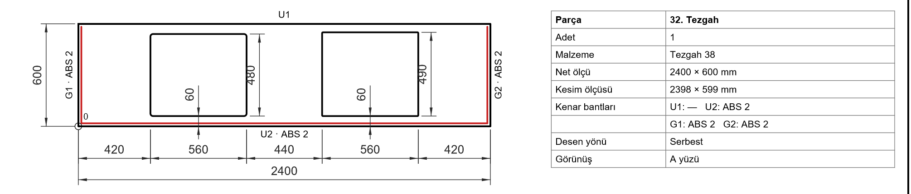
* **Nesting merkezi programı.** `Contour`'a `inner` bayrağı eklendi. Freze kesimin içinden
  gider (kontur yarıçap kadar küçültülür: kesim ölçüsünü korur). Bütün kesimler, parçalar
  henüz levhada tutunurken, her dış konturdan önce frezelenir. Saat yönünde dönen iş milinde
  tırmanma frezeleme: parçanın dışında saat yönünde, kesimin içinde tersine. Freze kesime
  sığmıyorsa kesim «diğer makinelere kalan işler»e gider.
* **Kesim planı** parçanın dış dikdörtgenini kullanır; kesimin içine başka parça konmaz.
* **3B.** Tezgah kesimlerin çevresinde parçalar hâlinde çizilir (kesim kenarlarına göre bir
  ızgara), yuvarlatmalar 3B'de düzdür. Kesime tıklamak altındaki dolabı seçer.

Kesim planında tezgah: 2400 mm standart 2800 × 2100 levhaya sığar. 3 m için stokta tezgah
plakaları gerekir, örneğin 4100 × 620: frezenin 10 mm'lik payları ile 600 kalır. Mutfak uçtan
uca testi böyle kurulmuştur.

### Yolda: kesim listesinde bir satır = aynı işleme

Mutfağı incelerken 6–9. aşamalardan kalan bir hata buldum. Kesim listesinin bir satırı
parçaları yalnızca türüne, ölçüsüne, malzemesine ve kenar bantlarına göre birleştiriyordu. Ama
çizim ve CNC programı satırın ilk parçasına göre yapılır. Sağ yan panel (delikleri soldakinin
aynadaki görüntüsü) sol panelin programını alıyordu; mutfakta da aynı ölçüdeki kapaklı ve
çekmeceli modüllerin yan panelleri «aynı parça» olurdu.

Artık `buildCutList` işlemeyi de, parçanın çiziminde göründüğü gibi karşılaştırır (`FlatPart`:
delikler, kanallar, kesimler; sıradan bağımsız, 0,01 mm tolerans), ayrıca ayna parçaların
«elini»: yan paneller, çekmece yanları, kapaklar (menteşe tarafına göre). Böyle bir satırın
adında el yazar: «Yan panel (sol)», «Kapak (sağ)». Bu yüzden gardıropta yan paneller ve
kapaklar artık birer parçalık iki satırda. Parça sayısı aynı, ama her satır tek bir parçayı
tanımlar.

### Arayüz

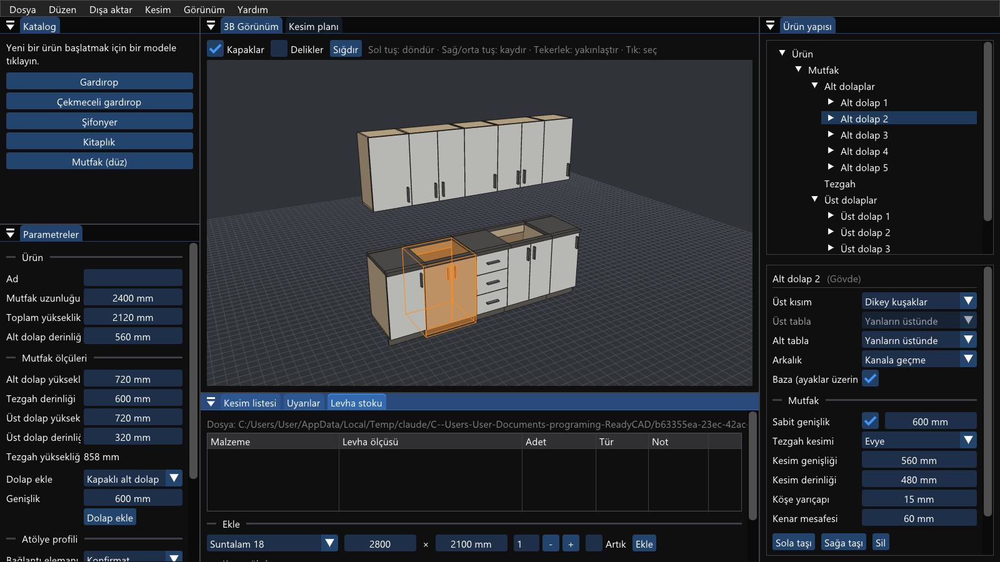

* Katalog: «Mutfak (düz)»: 2400'lük düz mutfak; 400'lük kapaklı modül, 600'lük evye,
  400'lük çekmeceler, 600'lük ocak ve 400'lük otomatik modül; üstlerinde beş üst dolap.
* Ağaç: «Alt dolaplar», «Tezgah», «Üst dolaplar», «Alt dolap 2» modülleri, «Ön kuşak».
* «Parametreler»: mutfak uzunluğu, toplam yükseklik, alt dolap derinliği, mutfak ölçüleri,
  tezgah yüksekliği (hesaplanır), «Dolap ekle» (modül ve genişlik). Atölye profilinde baza
  yüksekliği ve girintisi, kuşak genişliği.
* Modül özellikleri: üst kısım (üst tabla, yatay veya dikey kuşaklar), birleşimler, arkalık,
  baza, sabit genişlik, tezgah kesimi ve ölçüleri, «Sola taşı», «Sağa taşı», «Sil». Dizide
  «Dolap ekle» yalnızca o dizinin modüllerini önerir.
* `--catalog 4`: mutfak; `--select Carcass:2`: ikinci gövdeyi seç.

### Proje dosyası, sürüm 2

```json
"kitchen": {
  "sizes": {"baseHeight": 720, "wallHeight": 720, "wallDepth": 320, "worktopDepth": 600},
  "worktop": {"cutting": false},
  "base": [ {"topStyle": "uprightRails", "plinth": true, "width": 600,
             "cutout": {"kind": "sink", "width": 560, "depth": 480, "radius": 15,
                        "frontOffset": 60},
             "parts": {"frontRail": {...}}, "interior": {...}, ...} ],
  "wall": [ ... ]
}
```

Sürüm 1 dosyaları eskisi gibi açılır: gövdelerinde `topStyle` yoktur, demek ki üst tablaları
vardır.

### Bağlantı elemanları

Listeye ayaklar (bazalı her modüle 4, genişliğin her ek metresi için 2 daha), baza klipsleri
(her ön ayağa bir tane) ve askı aparatları (her üst dolaba 2) eklendi.

### Mutfak testleri

| Ne | Dosya |
|----|-------|
| Katalogdaki mutfağın geometrisi: baza, alt tabla, yan paneller, kuşaklar, kuşağın kanalındaki arkalık, kapaklar, tezgah, üst dolaplar; evyenin dikey kuşakları; bütün arkalık türleriyle kuşaklar; kuşak değişince malzeme korunur; mutfağın uzaması; kesimlerin yeri; kesim kuralları; modüllerin yer değiştirmesi; her gövdede baza; mutfak kurucusu | `core/tests/KitchenTests.cpp` |
| Konfirmatlı kuşaklar, kanal yalnızca arkadaki yatay kuşakta; modüller birbirine bağlanmaz; ayaklar, klipsler, askılar; tezgah kesim planı dışında tek satır | `detailing/tests/KitchenDetailingTests.cpp` |
| Bir satır = aynı işleme; ayna çiftleri | `detailing/tests/CutListTests.cpp` |
| Kesimleriyle tezgahın açınımı; kesimin konturu | `detailing/tests/FlatPartTests.cpp` |
| DXF'te `CUTOUT` katmanı ve ölçüler | `export/tests/DxfTests.cpp` |
| Kesimler önce, içeriden, doğru yönde frezelenir; dar kesim diğer makinelere kalır | `cam/tests/NestingCenterTests.cpp`, `cam/tests/OperationsTests.cpp` |
| Modül ekleme, genişliğini değiştirme, taşıma ve silme; yapılamayacak mutfak değişiklikleri reddedilir; konstrüksiyon gövdeye göre | `editor/tests/OperationsTests.cpp` |
| Mutfak bütün seçimleriyle kaydedilir; sürüm 1 projesi açılır | `storage/tests/StorageTests.cpp` |
| 3B'de kesimli tezgah | `render/tests/SceneTests.cpp` |
| **Mutfak yolculuğu**: 3 m, ek modüller, başka bir evye, 4100 × 620 plakadan CNC'de kesilen tezgah; projeler, kesimli çizim, programda tezgah konturundan önce kesimler; rastgele kullanıcı mutfak kurar | `tests/integration/KitchenJourneyTests.cpp`, `tests/integration/RobustnessTests.cpp` |

Henüz yapılmadı:
* boy dolapları (fırın, buzdolabı), aspiratör üstü dolap, ankastre cihaz nişleri;
* plakadan uzun tezgah: ek modellenmez, elle kesilir;
* çekmece raylarının delikleri delinmez (dolaplarda da);
* tezgah arası paneli, kornişler.

## Parçalarda kesimler ve oymalar (mutfaktan sonra)

Tez danışmanının isteği: parça her zaman bir dikdörtgen değildir. Süpürgelik için yan panelde
köşe kesimi, boru için kenarda kesim, masada veya TV ünitesinde kablo deliği, rafta yuvarlatılmış
köşeler gerekir. Öneri (altı tür, kurallar aşağıda) danışman tarafından tamamen kabul edildi.

### Kenarlara bağlı altı tür

| Tür (arayüzde) | Yapı | Ne girilir |
|---|---|---|
| Köşe kesimi | `CornerNotch` | köşe, parçanın boyu ve eni yönünde ölçü |
| Köşe yuvarlatma | `CornerRound` | köşe, yarıçap |
| Köşe pahı | `CornerChamfer` | köşe, iki dik kenar |
| Kenar kesimi | `EdgeNotch` | kenar, hangi köşesinden ölçüleceği, mesafe, boy, derinlik |
| İç kesim | `InnerCutout` | merkezin ölçüldüğü köşe, iki mesafe, ölçüler, köşe yarıçapı |
| Yuvarlak delik | `RoundHole` | aynı şekilde, çap |

Hepsi birlikte bir `std::variant`'tır (`ShapeFeature`, `core/PanelShape.hpp`); liste parçada
durur (`PanelComponent::shape()`) ve yerleşimde `Panel`'e kopyalanır. Köşeler ve kenarlar
çizimlerdeki gibi adlandırılır: U1, U2 uzun kenarlar, G1, G2 kısa kenarlar, köşe «U1–G1».
Konum her zaman mutlak koordinatlardan değil, kenarlardan ölçülür: «U1–G1, 100 × 15»
süpürgelik kesimi dolap yükselince arka alt köşede kalır; «U2–G2» köşesinden ölçülen bir
delik ön üst köşenin yanında durur.

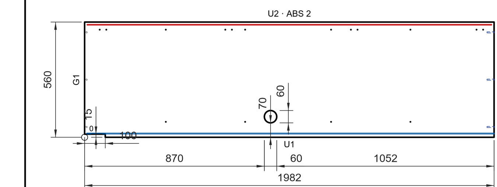

### Kenarlardan kontur

`panelOutline()`, U1–G1 köşesinden başlayarak parçayı saat yönünün tersine dolaşır. Her
köşeye kendi şeklini (köşe, kesimin basamağı, yay, pah), her kenar boyunca sırayla o kenarın
kesimlerini koyar. Konturun her kenarı nereden geldiğini bilir:

| Kontur kenarı | Bant |
|---|---|
| `Edge`: dört kenardan birinin parçası | o kenarın bandı |
| `Corner`: yuvarlatma veya pah | köşenin uzun kenarının bandı, yoksa kısa kenarınınki: müşteri bantlı bir kenar bekler |
| `Notch`: bir kesimin kenarı | yok: kenar bantlama makinesi iç köşeyi dolaşamaz |

`grow` parametresiyle aynı dolaşma **ham parçayı** verir: her kenar kendi payı kadar (ön
frezeleme eksi bant kalınlığı) dışarı kayar, kesimler net yerlerinde kalır. Böylece net kontur,
ham parça, ölçüsü ve bantları tek bir formülden çıkar. İç kesimler (`InnerCutout`,
`RoundHole`), tezgahtaki evye ile aynı `PanelCutout` yapısıdır ve aynı yolu izler.

### Yapılabilir mi

Şekil değişikliği, diğer her değişiklik gibi, parça üretilemiyorsa reddedilir:

* **sığmaz** (`shapeFits`, «kesim parçaya sığmaz»): bir köşede iki şekil; boydan boya ya da
  komşusuna kadar kesim; kontur kendini kesiyor (kesimler buluştu veya üst üste bindi); iç kesim
  parçanın dışına çıkıyor ya da kenara ve komşu kesime `minBridge` = 10 mm'den az malzeme
  bırakıyor;
* **işlemeye denk gelir** (`findShapeConflicts`, «delik veya kanal kesime denk gelir»):
  * yüzeydeki bir delik bütün dairesiyle malzemede olmalı;
  * kenardaki bir delik kendi kenarının kalan bir parçasından girmeli ve malzemede bitmeli;
  * bir kanal malzemenin içinden geçmeli.

560 mm'lik dolapta örnek: arkalık kanalı arka kenardan 16…20 mm'de geçer. 15 mm'lik süpürgelik
kesimi yanından geçer, 20 mm'lik ise kanalı keserdi ve reddedilir. Üst tablanın konfirmatlarının
yan panel ucuna girdiği köşe kesilemez. Denetimi detaylandırma yapar (deliklere ihtiyacı
vardır); `Document::edit` denetimden önce delikleri yeniden hesaplar.

### Bütün zincir boyunca

* **Kesim listesi:** kontur işleme karşılaştırmasına girer; bu yüzden yuvarlatılmış raf,
  düz raflardan ayrı bir satırdır.
* **DXF ve PDF çizimleri:**
  * parçanın (`CONTOUR`) ve ham parçanın (`CUT_CONTOUR`) konturu gerçek şeklindedir;
  * bant işaretleri kesimin içinden değil, bantlı kenarlar boyunca gider;
  * kesim kenarlarında ölçüler vardır;
  * parça sayfasında her şekil için «Kesimler» satırları bulunur («Köşe kesimi U1–G1: 100 × 15»).
* **Kesim planı:**
  * nesting merkezi ham parçayı gerçek şekliyle alır ve No-Fit Polygon ile yerleştirir:
    Aşama 7'de modeldeki şekilli parçaları «sonraya» bırakmıştık, artık varlar;
  * testere çevreleyen dikdörtgeni keser; özette «Testereden sonra yapılacak kesimler»
    bölümü çıkar: hangi parçalar CNC'de ya da elle tamamlanır.
* **CNC programı:**
  * dış kontur şekle göre, iç kesimler içeriden ve konturlardan önce frezelenir;
  * frezeden dar bir kesim makinede yapılamaz: freze onun üzerinden geçerdi. Bu şöyle anlaşılır:
    freze yarıçapı kadar büyütülüp geri küçültülen kontur daha dolu çıkar. Böyle bir kesim
    sessizce kaybolmaz, «diğer makinelere kalan işler»e gider.

  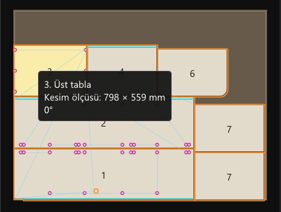
* **3B:** şekilli bir parça prizma olarak çizilir. Yüzey kulak kesme yöntemiyle üçgenlere
  ayrılır (`render/Triangulate.cpp`): her delik, gördüğü bir köşeye köprüyle kontura bağlanır
  (Eberly yöntemi), sonra üçgen «kulaklar» tek tek kesilir. Duvarlar kontur boyunca ve
  kesimlerin çevresinde, çizgiler konturun döndüğü yerlerdedir. Fareyle seçim üçgenlere
  bakar (Möller–Trumbore); bu yüzden bir kesime tıklamak arkasındakini seçer. Mutfak tezgahı
  da artık köşeleri yuvarlatılmış kesimleriyle bir prizmadır.
* **Proje dosyası:** sürüm 3; parçada `"shape": [{"type": "cornerNotch", "corner": "L1W1",
  "alongLength": 100, "alongWidth": 15}, ...]`. Sürüm 1 ve 2 dosyaları açılır.

### Arayüz

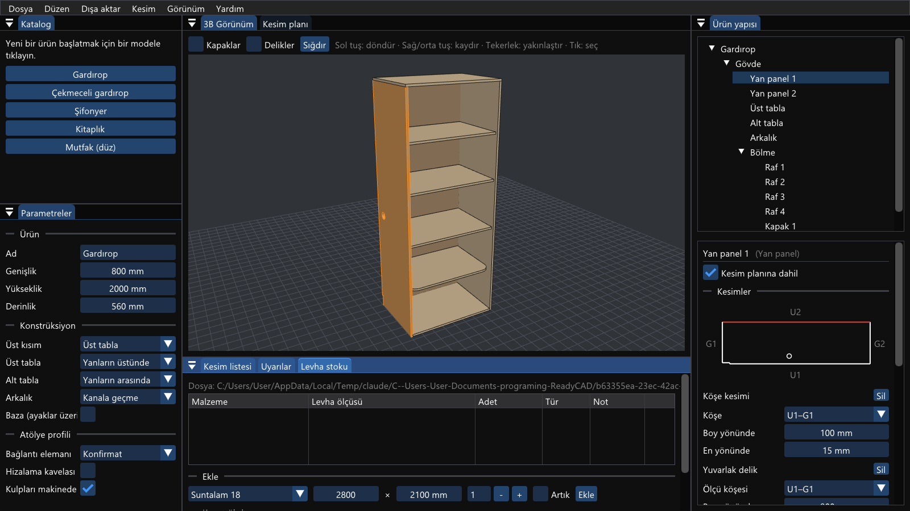

Her parçanın özelliklerinde «Kesimler» bölümü vardır:
* parçanın çizimindeki gibi bir taslağı: bantlı kenarlar kırmızı, kenar adları yazılı;
* otomatik kesimler (tezgahta evye) salt okunur;
* şekil listesi, alanlarıyla ve «Sil» düğmesiyle;
* «Kesim ekle», bu ölçüdeki parçaya sığan bir şekil ekler.

### Testler

| Ne | Dosya |
|-----|------|
| Her türün konturu, kenarları ve bantları, paylı ham parça, her köşeden iç kesimler, daire; neyin sığıp neyin sığmadığı; ölçü değişince şekillerin parçayı izlemesi | `core/tests/PanelShapeTests.cpp` |
| Kontur ve ham parçayla açınım; kesimlere karşı kanal, raf pimi delikleri ve kenardaki konfirmatlar; yuvarlatılmış raf ayrı satır | `detailing/tests/ShapeCheckTests.cpp` |
| Şeklin kabulü veya nedeni ve parça adıyla reddi; geri alma | `editor/tests/OperationsTests.cpp` |
| Şekiller kaydedilir; bilinmeyen tür dosya hatasıdır | `storage/tests/StorageTests.cpp` |
| DXF: altı noktalı kontur, ham parça, iç kesim, kesim ölçüleri, bant işaretleri | `export/tests/DxfTests.cpp` |
| Şekle ve dikdörtgene göre kesim planı; dar kesim diğer makinelere | `nesting/tests/FreeNestingTests.cpp`, `cam/tests/NestingCenterTests.cpp` |
| Üçgenleme: dikdörtgen, kesimler, birden çok iç kesim; 3B'de kesimli parça | `render/tests/TriangulateTests.cpp`, `render/tests/SceneTests.cpp` |
| Özette «testereden sonra» | `production/tests/SummaryTests.cpp` |
| **Şekil yolculuğu**: iki yan panelde kesim, rafta kablo deliği ve yuvarlatmalar; proje; DXF; CNC programı; testere; rastgele kullanıcı parçaları keser | `tests/integration/ShapeJourneyTests.cpp`, `tests/integration/RobustnessTests.cpp` |

Uzun çalıştırma: 60 oturum × 80 değişiklik, 4800 değişiklikten 3908'i kabul edildi, hiç ihlal yok.

Henüz yapılmadı: serbest biçimli eğri konturlar (DXF'ten içe aktarma), kenarda pah (kenar
profili), boydan boya olmayan cepler.

## Desenler ve dokular (kesimlerden sonra)

Tez danışmanının ikinci isteği: parçalar 3B'de gerçek malzeme gibi görünmeli. Kullanıcı CC0
lisanslı dokuz dikişsiz doku seçti (ambientCG):
* dört ahşap;
* üç mermer;
* beyaz plastik;
* yonga levha.

Damarlar soldan sağa gidecek şekilde döndürüldüler. `assets/textures` klasöründeler; kaynaklar ve
lisanslar `assets/textures/SOURCES.txt` dosyasında.

### Desen malzemenin özelliğidir

| Ne | Nerede | Neden |
|-----|-----|-------|
| `Decor`: id, ad, resim (ya da düz renk), ortalama renk, damarı var mı | `core/Decor.hpp` | kulp kataloğu gibi atölye verisi: her atölyede kendi tedarikçisinin desenleri |
| `ConstructionRules::decors`: katalog (varsayılan 11 desen: 9 resim, açık gri, antrasit) | ürünün kuralları | proje ve atölye profiliyle birlikte kaydedilir |
| `Material::decor`: desenin id'si | malzeme | varsayılan olarak gövde «Bej ahşap», kapaklar «Beyaz», tezgah «Gri mermer» |

**Başka desen, başka malzemedir.** Kesim planı, kesim listesi ve stok malzemeleri adlarından
ayırır. Bu yüzden `withDecor()` adın sonuna desenin adını ekler: «Suntalam 18» → «Suntalam 18
Beyaz» (önceki desenin adı birikmez, değiştirilir). Beyaz ve ceviz parçalar hiçbir zaman aynı
levhaya ve aynı satıra düşmez, stokta da ayrı kalemler olur. Varsayılan malzemelerin adları
aynı kalır («Suntalam 18»), bu yüzden eski adlarla tutulan atölye stoku hâlâ uyar.

**Damar desenden gelir.** Ahşap bir desende `grain = true`: malzeme `hasGrain` alır ve kesim
planı parçaları döndürmez (Aşama 7 kuralı). 3B'de resim, parçanın boyu boyunca gider: modelin
Aşama 2'den beri damar yönü saydığı eksen. Düz renk ve mermer döndürülebilir.

### Nasıl çizilir

* Sahne (`SceneSurface`) her parça için resmini, boy ve en eksenlerini ve bir çarpanı (seçilende
  turuncu) taşır. Deseni olmayan parça (arkalık, çekmece kutusu) eskisi gibi kendi türünün
  rengindedir.
* Resim doğrudan parça gölgelendiricisinde, yüzeyin normaline göre, ürünün milimetreleriyle
  serilir (800 mm'de bir karo):
  * yüzeyde parçanın boyu ve eni boyunca;
  * uzun kenarda boyu ve kalınlığı boyunca;
  * uçta eni ve kalınlığı boyunca.

  Bu yüzden damarlar yüzeyden kenara kesintisiz geçer ve her parça için ayrı bir koordinat
  tamponu gerekmez.
* `loadImage()` JPEG ve PNG'yi `stb_image` ile okur. Bu, FetchContent ile bağlanan ve bir
  commit'e sabitlenen tek bir başlık dosyasıdır; uygulaması bizim uyarı bayraklarımız
  olmadan ayrı bir kütüphanede derlenir. Dosyayı `std::filesystem` okur, bu yüzden Türkçe
  klasör adları sorun olmaz. Doku bir kez, mipmap'leriyle yüklenir. Resim okunamazsa yerine
  desenin ortalama rengi çizilir: program çökmez ve beyaz lekeler göstermez.
* `assets`, derlemeden sonra `ReadyCAD.exe`'nin yanına kopyalanır. Program bu klasörü önce
  kendi yanında, derleme klasöründen çalışırken kaynak ağacında arar (`ui/Assets.cpp`).

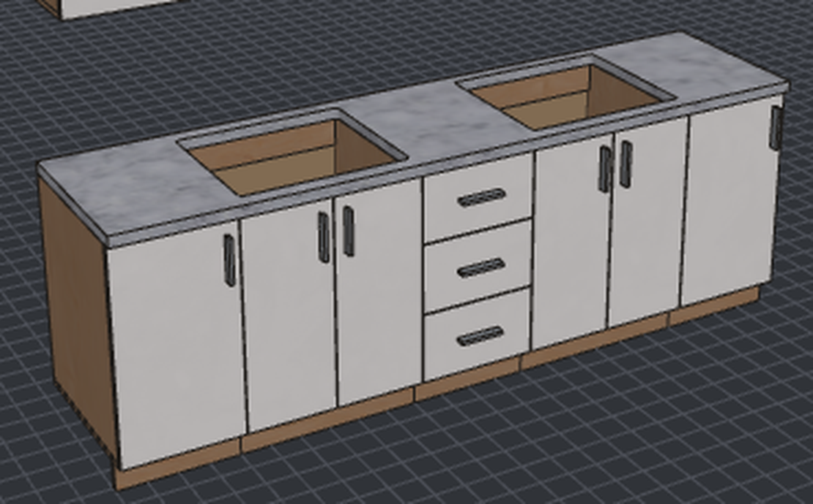

### Arayüz

* «Parametreler → Desenler»: gövdenin, kapakların ve mutfakta tezgahın deseni (renk örneği ve
  adı).
* Parçanın özelliklerinde «Desen»: «Varsayılan (malzemenin adı)» ya da kendi deseni. Kendi
  deseni, parçanın kendi malzemesidir (`setMaterialOverride`); bu yüzden her malzeme seçimi
  gibi geri alınır, kaydedilir ve kesim listesine girer.

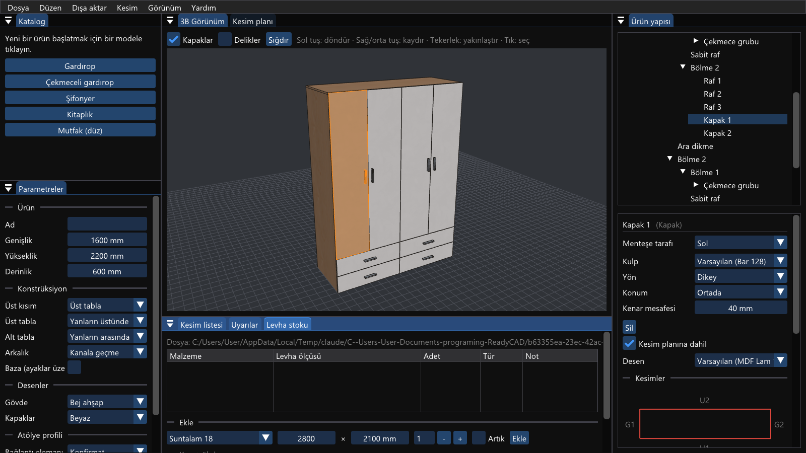

### Testler

| Ne | Dosya |
|-----|------|
| Katalog: tekil id'ler; varsayılan malzemeler ona başvurur, damarlar uyar; başka desende malzemenin adı, desenin değiştirilmesi ve kaldırılması | `core/tests/DecorTests.cpp` |
| Desenler ve desenli malzemeler kaydedilir; eski profil varsayılan kataloğu alır | `storage/tests/StorageTests.cpp` |
| Sahne: yan panelin ve üst tablanın resmi ve damar yönü, beyaz kapaklar, desensiz arkalık, yedek renk | `render/tests/SceneTests.cpp` |
| Kataloğun bütün resimleri okunur ve karedir; eksik veya bozuk dosya çökertmez | `render/tests/ImageTests.cpp` |

Proje biçimi sürüm 4, atölye profili sürüm 2. Eski dosyalar açılır.

## Köşe mutfakları (desenlerden sonra)

L mutfak, arka duvarda ve bir yan duvarda dolap dizisidir; U mutfak her iki yan duvarda da.
Köşe, mobilya atölyelerinde alışıldığı gibi **kör köşe dolabıyla** çözülür: alt ve üst. Katlanır
kapaklı L köşe dolabı bu aşamanın ikinci bölümüdür. Danışman planın tamamını onayladı.

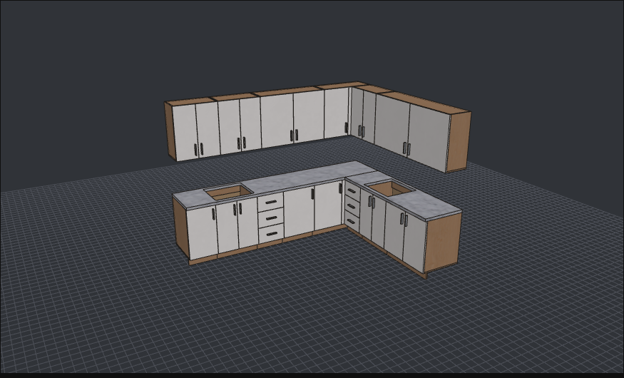

### Kendi koordinatlarında dizi

Aşamanın ana kararı. Her dizi (`KitchenRun`) düz mutfak gibi kendi koordinatlarında
yerleştirilir: boyu X boyunca, kapakları +Z yönünde, duvar Z = 0'da. Mutfak onu `Placement` ile
duvarına koyar: düşey Y ekseni çevresinde çeyrek tur döndürme ve kaydırma. Sol dizi bir tur
döner (+X'e bakar), sağ dizi üç tur (−X'e bakar).

Neden:
* dolapların formülleri, delikler, kesim listesi, kesim planı, CNC programları ve parça
  çizimleri parçanın hangi duvarda durduğunu bilmez. `detailing`, `nesting`, `cam`
  modüllerinde tek satır değişmedi;
* 90°'nin katı kadar döndürme modelin temel özelliğini korur: her şey eksenlere paraleldir.
  Parçanın kutusu yine tam bir kutudur, kutularla çakışma denetimi de tam kalır;
* oda koordinatlarına yalnızca üç kullanıcı ihtiyaç duyar: 3B sahne, çakışma denetimi (iki
  duvarın parçaları köşede buluşur) ve üstten görünüş. `FurnitureComponent::placement()`
  üst bileşenlerin yerleşimlerini toplar, `productBox()` kutuyu ürün koordinatlarında verir.

Buradan bilinçli bir sınır çıkar: kapağı 45° olan çapraz köşe dolapları yapılmaz, bu özelliği
bozarlar.

| Ne | Nerede |
|-----|-----|
| `Placement`: çeyrek turlar ve kaydırma; nokta, yön, kutu, eksen, iç içe yerleşim | `core/Placement.hpp` |
| `FurnitureComponent::placement()`, `productBox()`, `ownPlacement()` | `core/model/FurnitureComponent.hpp` |
| `KitchenRun`: duvar, alt ve üst dizi, tezgah, yan duvarın boyu; arka dizide köşeler | `core/model/Kitchen.hpp` |
| `KitchenCorner`: arka dizinin ucu, alt ve üst kör köşe dolabı | aynı yerde |
| `Carcass::setBlindCorner(filler)`, `BlindPanel` (kör panel) | `Carcass.hpp`, `Parts.hpp` |
| `KitchenFrame`: yükseklikler, derinlikler, `cornerBase` / `cornerWall`; `CornerFrame`; `plinthBeyondStart/End` | `core/model/LayoutSlot.hpp` |
| `makeCorner()`, `KitchenBuilder::sideWall()`, duvarı belirtilen modüller | `core/builders/KitchenBuilder.hpp` |

### Köşe

```
   arka duvar                         sağ duvar
  ─────────────────────────────────┐
   …│      köşe dolabı 1100        │
    │  kapak │dolgu│  gizli 578    │
  ──┴────────┴─────┼───────────────┤
                   │ yan dizi      │
```

* Köşe dolapları arka dizinin ucunda durur: alt 1100 mm, üst 800 mm.
* Yan dizi, köşe dolabının gizli bölümünün bittiği yerde başlar: arka dizinin dolap
  derinliği ve kapak kalınlığı kadar (560 + 18 = 578 mm, üst dolaplarda 320 + 18 = 338 mm).
  İki değeri de mutfağın tek bir fonksiyonu hesaplar (`KitchenFrame::cornerBase`,
  `cornerWall`). Bu yüzden köşe dolabı ile yan dizi hiçbir ölçü değişikliğinde birbirinden
  ayrılamaz.
* Köşe dolabının ön yüzü:
  * kapak açık bölümde, menteşeleri köşeden uzak tarafta;
  * kapakla aynı hizada kör panel — gizli bölümün ve 50 mm dolgunun üstünde. Dolgu, iki
    duvarın kapakları ve kulpları birbirine çarpmasın diye vardır;
  * kapak, panelden bir kapak aralığı önce biter. Bunun için gövde kendi bölmesinin kapak
    taşmasını azaltır (taşma eksi olabilir); raflar ise tam genişlikte kalır: kör bölüme
    eşya konur.
* Baza köşeyi döner. Köşe dolabının bazası yan duvar bazasının arka yüzüne kadar uzanır (yan
  duvardan 560 − 40 − 18 = 502 mm). Yan dizinin ilk bazası köşe dolabı bazasının ön yüzüne kadar
  geri uzanır (kendi gövdesinden 18 + 40 = 58 mm öteye). Bu olmasa iç köşede bir boşluk kalırdı.
* Tezgah: arka tezgah yan duvara kadar gider, yan tezgah onun ön kenarından başlar — alın
  alına ek. Duvardaki uçlarda ve ekte bant yoktur (`KitchenFrame::startClosed`, `endClosed`).
  45° ek özel ekipman ister ve yapılmaz.

### Çizimler

* Üstten görünüş (`ProductView::Plan`): ekli tezgahlar, evye ve ocak kesimleri, duvar boyları.
  Üst dolaplar bu görünüşte yoktur. Köşe mutfağında bu görünüş PDF'in kapağında ve ayrı
  «Yerleşim planı» sayfasındadır.
* Açınımlar: «Montaj çizimi — Arka duvar», «— Sağ duvar» vb. Düz mutfaktaki üç görünüşün aynısı,
  her dizi için kendi koordinatlarında: montajcı duvarı karşısında durarak böyle görür.
  Görünüşler herhangi bir alt ağacı kabul eder — ürünün tamamını ya da bir diziyi.

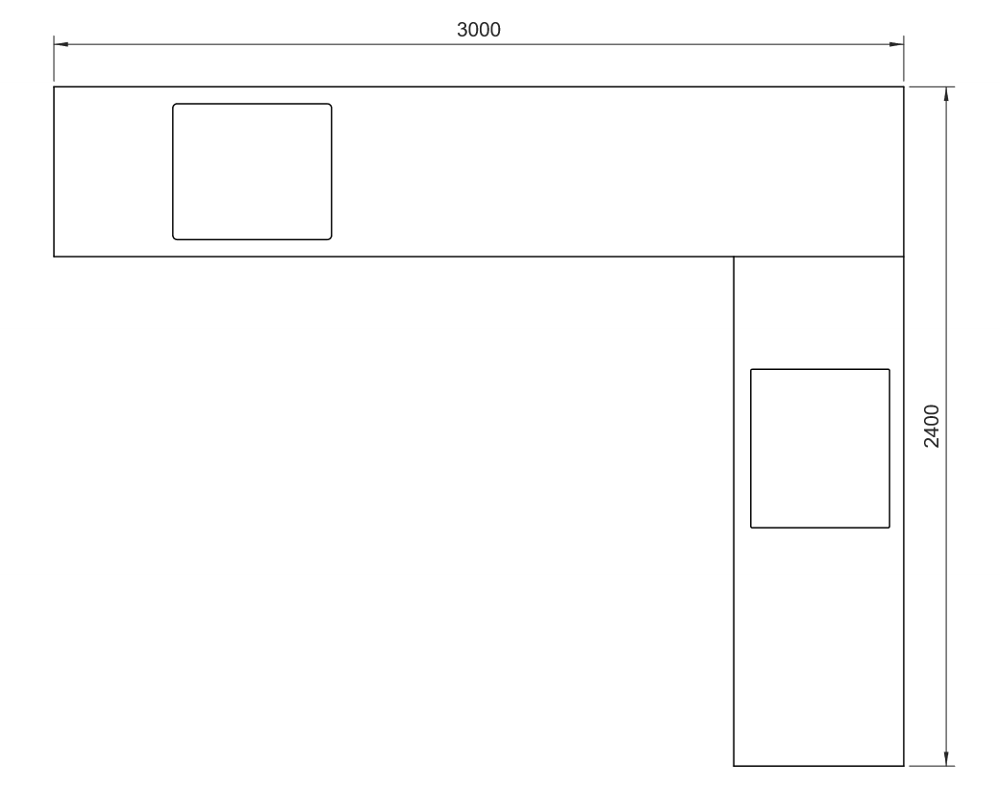

### Proje dosyası, sürüm 5

Arka dizi, eskiden düz mutfak nasıl yazılıyorsa öyle yazılır; bu yüzden eski dosyalar düz
mutfak olarak okunur. Yan dizi `"left"` / `"right"` altındadır: boy, köşe
(`"corner": {"base", "wall"}`), tezgah ve diziler. Köşe gövdesinde `"blindFiller"` vardır, kör
panelinin kendi seçimleri de (`"parts": {"blindPanel": …}`).

### Arayüz

* «Mutfak»: «Sol duvar» ve «Sağ duvar» — onay kutusu ve duvarın boyu. Yeni duvar köşesiyle ve
  her dizide bir dolapla gelir. «Dolap ekle» içindeki «Duvar», dolabın nereye ekleneceğini
  seçer.
* «Köşe»: alt ve üst dolabın genişlikleri ve dolguları. Köşe dolabı taşınmaz, silinmez ve
  otomatik genişliğe geçmez.
* Ağaç: Mutfak → Arka duvar (Alt dolaplar, Tezgah, Üst dolaplar, Sağ köşe → Kör köşe alt dolabı,
  Kör köşe üst dolabı) → Sağ duvar.
* Katalog: «Mutfak (L)» — arka duvar 3000, sağ duvar 2400; «Mutfak (U)» — 3200, yan duvarlar
  2000'er.

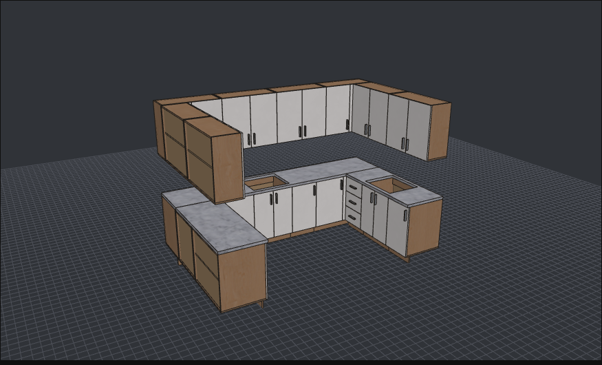

### Testler

| Ne | Dosya |
|-----|------|
| Döndürmeler: noktalar, kutular, eksenler, iç içe yerleşim | `core/tests/CornerKitchenTests.cpp` |
| L mutfak: köşe dolapları, kör panel ve kapak, kendi ve ortak koordinatlarda yan dizi, tezgahlar ve bantları, bazalar | aynı dosya |
| U mutfak: iki köşe, sol dizi, ölçü değişikliği; yan diziler köşeleriyle gelir ve gider | aynı dosya |
| Kataloğun bütün modelleri (artık yedi) çakışmasız, ölçü değiştikten sonra da | `core/tests/ParametricTests.cpp` |
| L ve U kaydedilir ve okunur | `storage/tests/StorageTests.cpp` |
| Düzenleyici: duvarlar, doğru duvara dolap, köşe dolapları, geri alma, çok kısa duvarın reddi | `editor/tests/OperationsTests.cpp` |
| 3B: yan dizi kendi duvarına döndürülür, damar, sahne sınırları | `render/tests/SceneTests.cpp` |
| Üstten görünüş ve açınımlar | `export/tests/ProductViewTests.cpp` |
